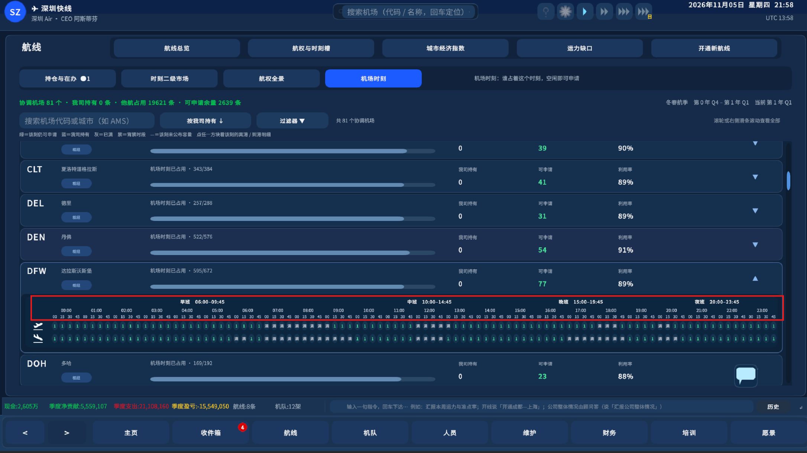
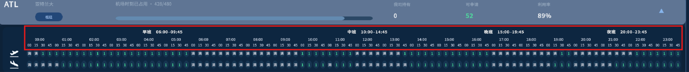
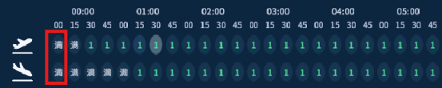
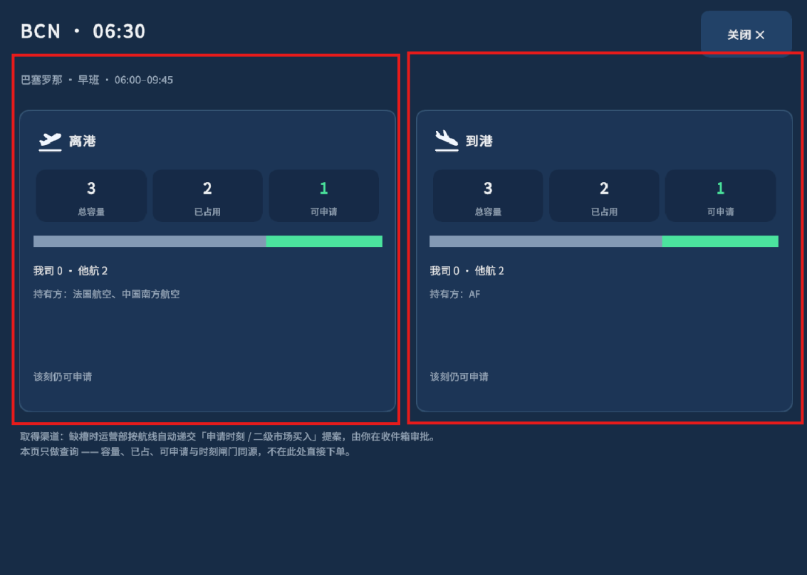

# Codex 任务：机场时刻全天展示与分方向详情

任务标识：UI-SLOT-20261109-01 · 版本 v1.0 · 日期 2026-11-09
状态：Codex 已明确本轮允许实施范围；Cursor 阅读后简短确认，无技术异议即可按本任务开发。如有实际阻断先反馈 Codex，不把专业选项交用户选择。
关联：三方工作流程与操作方法 v1.2；批次一 C0 兼容容量抽取已完成日常审查。
当前协作 revision：1021，Codex 已同步并 ack。

## 1. 用户原意

用户提出三件事：
1. 当前时刻容量是否已经按此前讨论的时刻容量模型修改？
2. 机场时刻应清楚地显示完整 24 小时，不应让人从表头读成只有 23:45–06:00 或 23:45–00:00。
3. 点击离港数字应打开离港信息页，点击到港数字应打开到港信息页，不再打开同一个双向并列页。

本轮解决第 2、3 项的界面问题。第 1 项只核实说明，不授权调整容量、三个旋钮或启用 B 布局。

截图已保存在附件目录，不依赖可能被清理的系统临时路径：

- 图一：
- 图二：
- 图三：
- 图四：

## 2. 已核对的源码事实

- Data/CapacityService.cs 的 Active 仍为 C0_FlatRunway，SlotsPerRunwayPerQuarter = 1。当前在协调开放且非宵禁的时刻按等效跑道数 × 1 给容量。首批只做结构抽取及索引，不改变数值。
- D16/D12 新容量模式、75%/60% 初始占用率候选、机场容量演进、B 布局均未因此启用。不要把“完成 C0 抽取”写成“完成三旋钮模型上线”。
- Logic/ScheduleSlots.cs 的 BandOfDep 仍把 00:00–09:45 归旧早段；BandHourStart 却在文案上将其起点写为 06:00。旧注释依赖“凌晨容量恒为零”，现已不适用于部分机场。
- UI/AirportSlotsView.cs 的 MatrixGrid 先按文案区间裁列，再用已有 chip 补列。因此有些机场凌晨列出现，却仍位于“早班 06:00–09:45”标题下面；另一些零容量时段可能不显示。标题与轴线不一致是本轮必须修正的显示问题。
- SlotCell 已收到 departure，但 Button 回调到 OpenDetail 时没有传递方向；AirportSlotDetailModal.Open/Build 也不收方向，Build 总是同时创建 Dep 和 Arr 两张卡片。

以上为代码审查结论，不是本轮 Unity 实机复现。截图中的小时行可见从 00:00 至 23:00，末刻为 23:45；不应简单将用户的问题归因为没有发现横轴，而应消除标题错配和按机场裁列造成的不一致。

## 3. 允许实施 A：固定全天时间轴

目标：每个展开的协调机场都显示同一条完整的民用日时间轴，00:00 至 23:45，每 15 分钟一列，共 96 列；界面明确“全天 00:00–24:00”。24:00 可以作为右端日界线，不能多生成第 97 条可申请槽。

实施要求：

- 96 列不随容量、占用或是否有 chip 增减；宵禁、未开放或未公布的时刻也保留位置。无容量不等于没有这个时间。
- 每小时对应 00/15/30/45 四刻，离港和到港严格使用同一列序；最左 00:00，最右槽 23:45。不用从 23:45 开始的环形列序。
- 表头按显示时钟正确分组。采用显示层的五段：凌晨 00:00–05:45、早班 06:00–09:45、中班 10:00–14:45、晚班 15:00–19:45、夜间 20:00–23:45；“凌晨/夜间”是视图时间描述，不另建业务池、不伪称已经改成 B。如现有布局需要适配，保持这五个范围和全天轴的清楚呈现，不向用户再抛技术选项。
- 从全部旧业务池收集实际数据，再按真实 clock 对齐到固定全天网格。业务查询仍用现有 BandOfClock；不能把“显示分段下标”直接当“业务池下标”。00:00–05:45 的数据仍从当前旧早池取得。
- 弹窗副标题也按实际显示时间段表达，避免点击凌晨时仍写“早班 06:00–09:45”。不要为修正文案改动全局 BandHourStart/End、BandOfDep 或业务日期。
- 状态沿用真实规则：宵禁优先显示“禁”；无容量/未开放明确显示“—”；有容量但无剩余才显示“满”；有余量显示真实数值。判断宵禁不能先要求 chip.capacity > 0，否则零容量宵禁永远显示不成“禁”。非协调/协调时段外与宵禁仍是不同状态，不能伪造可申请数。
- 维持已有机场折叠、搜索、滚动及表格交互。常见窗口尺寸下表头、刻度、两条泳道清楚对齐，无遮挡或错列。

## 4. 允许实施 B：方向明确的只读详情

- 离港行点击传递 DEP；到港行点击传递 ARR。方向沿 SlotCell → OpenDetail → AirportSlotDetailModal.Open/Build 全程显式传递，可复用现有 SlotHolding 方向常量，不需要新增业务模型。
- 点击离港，只渲染离港详情；点击到港，只渲染到港详情。允许复用同一弹窗组件，但呈现内容必须依方向选择，不能继续同时显示两端。
- 标题明确写“机场 · 时刻 · 离港/到港”。内容区合理利用宽度，不把另一半留成空白。
- 总容量、已占、我司、他航、可申请、持有方与状态都从选中方向的数据读取，不能只换标题；两方向数值刚好相同是允许的，不为区分页面而造不同数字。
- 持有方信息沿用选中方向的既有数据。不要把离港 holderNames 用到 ARR，也不要新增一套推导占用算法。
- 弹窗保持只读。沿用关闭、返回和重复打开行为，不增加手动申请/买入按钮，不改变运营部提案和收件箱审批流程。

## 5. 明确保护边界

只改本任务所需显示层、事件参数传递、必要视图辅助函数和针对性测试。

不改 CapacityService、跑道值、容量曲线、占用率、价格、持仓、存档、申请/成交/结算规则。不改 ScheduleSlots.BandOfDep 或 BandGrid 的业务归属，不启用 B 布局，不重排后台 FillWave，不重构 Place，不增加机场身份迁移或三个旋钮玩法。

若修复发现必须跨越以上边界，先向 Codex 给出代码证据和最小方案；不要自行扩大范围，也不要让用户选择专业技术路线。

## 6. 验收与自测

1. DFW、ATL 等全天机场，PEK、BCN 等有宵禁机场，以及有限协调窗口机场：展开后均为固定 96 列，整点与四刻头正确，午夜及零容量列不丢失、不重复。
2. 00:00、05:45、06:00、09:45、10:00、14:45、15:00、19:45、20:00、23:45 等边界列与其显示标题一致；午夜后六小时不再挂在错误的早班标题下。24:00 不变为新槽。
3. 用真实按钮绑定事件验证 DEP/ARR 方向传递，不只直接调用弹窗构造；两类点击分别仅生成相应详情内容。
4. 至少选择或构造一个 DEP/ARR 数据不同的 UI 夹具，核对两端容量、已占、可申请和持有方读取正确；这只用于验证 UI 取字段，不把夹具当真实市场合法性证明。
5. 同一机场、同一时刻，矩阵数字与相应方向弹窗、实际查询结果一致；关闭再开或换机场/时刻不串方向、不沿用旧内容。
6. 用隔离环境执行必要编译与定向 UI EditMode/PlayMode 测试，以实际可覆盖按钮/弹窗的最小入口为准。不得运行完整 LogicSelfTests.Run() 冒充定向回归。
7. C0 逐刻/池容量等价与现有申请序列回归继续通过，证明本轮未通过修改业务数字修饰界面。没有相关变化不反复扩大测试。

## 7. Cursor 回报与用户目测

Cursor 简短确认范围后实现、自测，给出改动清单、真实执行结果、未测项、修后截图及下面目测入口；先交 Codex 审查，再请用户目测。

用户操作：航线 → 航权与时刻槽 → 机场时刻，依次展开 DFW/ATL 与 PEK/BCN。确认显示全天，凌晨/早班标题正确、宵禁格保留；再分别点击同一时刻上下两行，确认分别出现离港页与到港页。无需新局或删除存档。

用户要求的第 1 项由 Codex 说明“目前只完成 C0 结构抽取，未启用新容量及三旋钮参数”，不要借本轮 UI 修复顺带上线新模型。

日常不自动 stage-close、不生成 DEL、不提交/推送；后续收口按用户明确指示执行。
