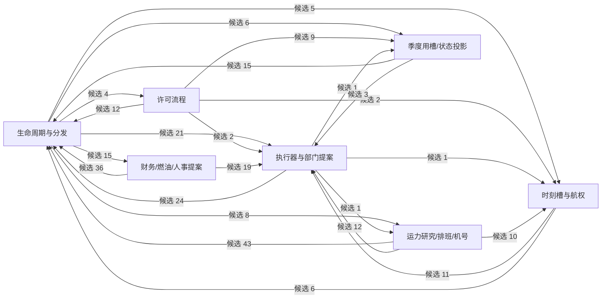
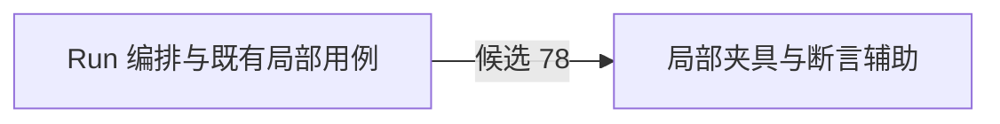
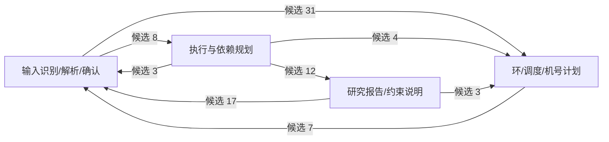
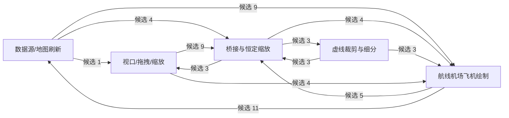
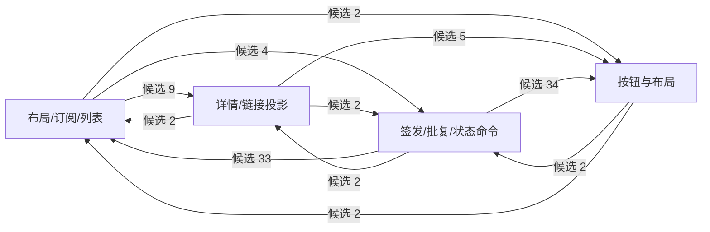

# Code Health Scan · Phase 0 · 2026-10-31

状态：体检报告待用户与 Cursor 确认范围。未进入 Phase 1；没有改生产代码、测试、资源或历史验收结论。

## 1. 基线、方法与结论边界

- 工作区：`C:/Users/jiliy/Airline-CEO-Simulator`；开始 HEAD `efe108b`；结束 HEAD `35a8770`（其他协作方在扫描期间提交文档与 PNG 重命名，见末尾边界说明）；开始时 `git status --short` 为空。协作恢复已完成，ack revision 833。
- 依据：`docs/handoff/Codex_代码体检指令_2026-10-31.md`。用户本轮明确限定 Phase 0，生产代码修改授权尚未进入执行范围。
- 工具：`rg --files "Unity Project/Assets" tools` 枚举；Node 逐文件读取、按词法屏蔽注释/字符串后提取带花括号的方法、调用词和类型；自动计数语料仅为枚举到的 C# 文件（不含 JS/JSON/YAML），原始标识符全词计数包含注释和字符串，以减少漏掉字符串入口的风险；JSON 逐字段体积与文件 stat；Git 追踪文件清单。
- 支撑资料：同目录 `Code_Health_Scan_2026-10-31.evidence.json` 保存全量候选、重复体和热路径行；`Code_Health_Scan_2026-10-31.graph.json` 保存五个文件的候选跨块调用统计；`Code_Health_Scan_2026-10-31.storage.json` 保存交付体积、工程引用数和快照目录清单。扫描脚本仅置于忽略目录 `.collab-local/code-health-*.cjs`，不进入 Unity。
- 这不是 Roslyn 全程序可达性证明：不解析重载绑定、接口派发、泛型推断、宏可达性、继承关系或拼接反射字符串；表达式体方法会漏检。字段候选中还可能混入表达式体属性。附录统一称“单次出现候选”，不能直接批量删除。
- 未启动 Unity、未触发刷新、未执行完整 LogicSelfTests.Run()，未跑 clean-checkout-verify，未 git add/commit/push。没有重新跑行为回归，因为本轮仅做静态体检；既有测试记录不等于本轮新证据。

本轮完整 out 目录盘点：128620287131 bytes（119.79 GiB），2349584 个文件，72 个一级目录。按文件逻辑长度求和，非 NTFS 实际分配空间，未做硬链接去重；这是当前可回收性设计的容量输入，不代表全部可删。

**核心判断**：先做少量可证明删除与 Editor 辅助函数收敛，再讨论结构重构。当前证据不能承诺净删 8% 或冷启动快 20%。单纯 partial 分文件不会减少编译的代码总量，也不会减少总行数。禁止为了达标移除测试、序列化字段或事故说明。

## 2. 死代码：候选与排除规则

扫描先列 `类型/方法/字段名全词只出现一次`，再按 Unity/存档入口复核。这里“确认”仅用于已确认仍有隐式入口的反例；**确认可直接删除的生产符号为 0**。候选是完整扫描输出，不是承诺删除清单。

优先逐个复核：

- `SetupFlowController.ReadField`，`UI/Setup/SetupFlowController.cs:808`：隐式 private static、5 行、字面检索仅定义，是目前较低风险的删除候选。检索 `rg -n 'ReadField' "Unity Project/Assets" tools`。方法体只读 TMP 输入并 trim；还需确认命令行执行入口、外部脚本与历史保存对象没有拼接调用，未在此轮宣布可删除。
- `CoordConverter.Gcj02ToWgs84`，`UI/CoordConverter.cs:42`：public 转换 API，当前检索仅定义；外部调用与未来接口风险高于 private helper，暂不纳入首批。
- `CashMeter.SetImmediate/AnimateTo`，`UI/CashMeter.cs:101/111`：公开组件方法，需检查 UnityEvent 的 `m_MethodName`、挂载 GUID 和场景/预制体；“C# 无调用”不足以删除。
- `SetupFlowController.ForceEnterGameplayForTests:90`：测试入口命名不代表无用；需覆盖外部回归工具和字符串调用，暂保留。
- `UITheme.LeftNavWidth` 与 UIFactory 的 TailDownSprite/ClockSprite/PauseSprite/PlaySprite：候选包含属性，不能直接当未使用字段处理；先判断是否反射、工具或 UI 配置依赖。
- `UiDomainModels.StaffProfile/AuditDef`、`StrategySave/MaintenanceSave/SafetySave/CarbonState`：存档或数据模型；即便仅见定义也不批准删字段或类型。必须按 Serializable 与旧存档往返约束处理。

已确认不能据零显式引用删除的反例：`SymbolFontImportSettings` 由 AssetPostprocessor 调用；SetupMVPScene 和 Phase*DebugMenu 等由 MenuItem/EditorWindow 入口加载；ResetStatics 由 RuntimeInitializeOnLoadMethod 调用。原始清单中这些假阳性保留以便审阅，不计入可删收益。

检索范围复核命令：

```powershell
rg -n '符号名' 'Unity Project/Assets' tools
rg -n 'SendMessage|BroadcastMessage|GetMethod\(|GetField\(|GetType\(|m_MethodName|MenuItem|SerializeField|Serializable|JsonUtility|nameof' 'Unity Project/Assets' tools
# 类型删除另查脚本 .meta GUID 在 prefab / unity / asset 中的 m_Script 引用；不能删除 .meta。
```

已发现真实反射调用：OpenFinancePanelMenu/OpenCommercePanelMenu/OpsManualTestMenu 通过 GetMethod 调用 ShowNavPanel/EnterGameplay；测试通过 GetField 读取面板字段。这些约束意味着不能仅凭 C# 直接调用计数做删除证明。未穷举所有拼接字符串；Phase 1 必须逐条补证，不能声称已全部排除。

## 3. 重复实现与合并优先级

以下附录按“方法体去空白后完全一致，长度至少 100 字符”聚类，保留字符串字面量；相同方法体仍可能依赖不同实例字段/泛型/程序集，不能自动合并。`tools/recover/*.cs` 的历史恢复副本从生产重复候选排除。

首选：Editor 的 OpenFinancePanelMenu/OpenCommercePanelMenu.EnsureInGameplay（2×12 行，含反射，需原样保留行为）；CreateUIConfigAssets/CreateSetupProfileAssets/BatchCreateDataAssets 的 EnsureFolder/Ensure；CreateOpsPrefabs/CreateFrameworkPrefabs.Ensure；OpenRouteStudyRegression/CeoCommandRegression.Trim。可在同 Editor 程序集共享，不改菜单入口与异常策略。

第二档：LogicSelfTests 与 CapacityReceiptRegression.LastPendingMail（2×11 行），但前者可能捕获 Run 局部状态，先解清捕获再合并，禁止删断言。

暂缓：各业务 SubpagePanel 的 BindPage/ResolveRefs/L/B。重复确实存在，但事件解绑、生命周期、基类私有字段、方法遮蔽必须一起核对；不合并产品面板，不改文案。先共享最小工厂函数而非重造面板架构。

`NumberAfter` 目前在 Assets/tools 的检索仅见 T038UiAcceptancePlayModeTests 一处定义，不能把指令中的举例当成实际重复。格式化、Clamp、Clock 等同名也不代表语义一致；特别不能合并不同精度/舍入方向的现金、日期函数。

## 4. 五个巨文件：职责边界与依赖

下方自动列出每块起点、方法数量、跨块调用候选与方向图。统计单位是“词法调用位置”，不是唯一调用边；按方法名匹配，同名重载/嵌套类会产生误配，**不能作为编译器准确调用数**。原始边在 graph/evidence 文件可复核。该计数用于比较耦合程度，真正移动方法前需要符号级解析。

- InboxManager：建议七块逻辑边界（生命周期、许可、执行器、槽/航权、部门提案、运力/排班/机号、季度/状态）；第一刀优先只抽文本投影与纯查询，Approve/ProcessPendingEffects 作为原有编排保留。Add/Schedule/DeliverDue 是共享枢纽；静态延迟回执队列绝不能挪成每实例队列或改变投递顺序。运力大块还需后续再分，七块本身不足以保证文件都 <1000 行。
- LogicSelfTests：先按“Run 编排”和“局部夹具”两层分析，再按现有断言主题分套件。Run 从第 22 行延续到 5552 行，辅助函数在其大作用域内。**不能**直接把这些局部函数移动到 partial 文件；需保持捕获、断言顺序、静态重置顺序。优先已有独立 Regression 文件的主题，禁止借拆分删除断言或执行完整 Run 代替隔离套件。
- CapacityDirectiveLogic：四块：解析/确认、执行依赖计划、研究报告/约束说明、环与机号规划。保持 Parse/Plan/Execute 公共入口和学习查询注入；不能把 Plan 试算路径和 Execute 落地路径混合，不能重排浮点运算。
- MapWidget：五块：刷新编排、地图绘制、桥接/恒定缩放、虚线细分、视口拖拽。该文件包含多种类，不能把文件行数误称单个类大小。MonoBehaviour 拆文件需保留原脚本身份、GUID、类型名和资源引用；优先非组件计算段，缩放广播顺序保持不变。
- InboxPanelUI：四块：布局订阅/列表、详情链接、按钮布局、签发批复命令。保持 OnEnable/OnDisable 配对、同一封邮件的按钮闭包和批复入口。只读投影先拆，审批和状态变更放在最后；不改交互流程。

## 5. 热路径候选与真实频率

静态命中不等于 GC 热点。`new Vector2/Color/UIFactory.Anchor` 可能是值类型，不应当作堆分配；异常 new 仅失败路径执行。Refresh 不一定每帧执行，附录含事件型 UI 刷新，需分别标注。

优先测量链：

1. `MVPBootstrap.ClockLoop:875` 使用 WaitForSecondsRealtime(0.5f)，每 0.5 秒经 RefreshClock:891→MapWidget.RefreshLivePlanes:602，后者又有 1.5 秒节流才 RebuildDynamicLayers；地图飞机刷新与选中卡片的字符串格式化应在这条链测 GC.Alloc/CPU。等待对象已在循环外创建，不要重复“优化”它。
2. `MapWidget` 的两个 Update（1587、1826）分别仅处理待缩放和尺寸变化；后续 SetViewScale/Apply 可能触发 RebuildDynamicLayers、GetComponentInParent、GetComponentsInChildren、线条重建。只应在变化时缓存/复用，必须保留缩放补偿和视口裁剪；不能声称无条件每帧全图重建。
3. `MapFlightCard.Refresh:148` 扫 activeRoutes，生成时间/阶段字符串并更新多个 TMP 字段；建议只在 route/phase/分钟实际改变时更新，但这是缓存失效设计，需逐项等价性验证，不能在 Phase 1 顺带实现。
4. `RegressionTriggerBridge.Tick:183` 每 Editor update 被调，但 1 秒节流后才检查 OFF/目录并 Directory.GetFiles；有文件才处理。可评估空闲轮询成本，禁止扩大白名单或改变 Play/编译时拒跑规则。
5. StaffProfilePanel/DepartmentInfoPanel/ChemistryVisualUI 等 Refresh 包含 Transform.Find/GetComponent/List/HashSet/StringBuilder，属于打开/事件刷新候选；没有本轮 Profiler 记录，不归为已确认每帧瓶颈。

后续基准要求：同一航线数、飞机数、缩放范围，分空闲/拖拽/1×推进三个场景，记录 median/p95 CPU 与 GC bytes/帧（至少 300 帧）；本轮未测，不给虚构的毫秒收益。

## 6. Unity 自动入口与导入开销

复核 `rg -n 'InitializeOnLoad|AssetPostprocessor' "Unity Project/Assets" -g '*.cs'`：14 是宽字符串匹配行数（含注释、RuntimeInitializeOnLoadMethod），并非 14 个编辑器导入钩子。明确的 Editor 入口是 3 个 InitializeOnLoad 类 + 1 个 InitializeOnLoadMethod 方法 + 1 个 AssetPostprocessor 类；另有 5 个 runtime 初始化属性。

逐项成本估算（按操作规模给上界形态；未加插桩，无法提供单项可靠 ms）：

- DevelopmentPlaySmoke.cs:16：静态构造创建 HashSet/List 并注册 update、日志回调，初始化为常数级；空闲 Tick 一次 SessionState bool 读取，运行 smoke 后 FindObjects/LINQ 才是 O(场景对象数)。风险是常驻轮询而非已证实导入大头。毫秒未知。
- RegressionTriggerBridge.cs:50：静态初始化建立约 22 项白名单及 List、订阅 update；空闲 update 常数检查，1 秒一次目录扫描 O(触发文件数)。毫秒未知，必须拆开“初始化”和“长期空闲轮询”。
- WeatherTileDomainReload.cs:22：构造只订阅 beforeAssemblyReload；重载时 AbortAll/ReleaseDomainResources 与在飞请求数相关，不能作为无用钩子删除。毫秒未知；没有请求时与网络超时时不可混测。
- DirectiveLexicon.cs:87 BootEditor→Boot→EnsureLoaded：清空内存并读取学习记录/注册查询；复杂度随记忆条目/文件大小增长。可能有磁盘 IO，应优先单独计时；不能删 Editor 注册，否则 EditMode 菜单解析静默失效。
- SymbolFontImportSettings.cs:7 OnPreprocessFont：每字体先做两个路径字符串判定，仅匹配 SegoeUISymbol 时设置三个 importer 属性；是逐字体常数成本，字体真正 raster/import 时间不是这几行的专属耗时。毫秒未知。
- Runtime 项：DirectiveLexicon.Boot、EconomyBalanceParams 初始化、WebRequestGuard.Reset、MapWeatherTileLayer 静态重置、RealWeatherService 静态重置。它们用于播放/子系统注册，不能统算作 Editor 冷导入钩子。

既有本机日志补充（未重跑）：`out/collab/DEL-20261031081842-1227f3/Unity Project/Logs/Tasks20261017_32c69b4789516068.log`，第 7111 行 InitialRefresh Total 427.037 s；1955 行 script compilation 126.374611 s，CompileScripts 126819.182 ms；编译已包含在 Refresh 分解中，**不能再相加**。ProcessInitializeOnLoadAttributes 两次为 155/2543 ms，MethodAttributes 为 89/203 ms，是全工程/包聚合数据，不能分摊给上面五项。Cursor 的 29.76 s +11.98 s 是另一轮基线，和这轮不可直接算优化百分比。

测量方案：用户批准后在隔离环境使用 Editor Profiler 或仅诊断插桩分别采 ctor/回调耗时，冷 Library 与热 Library 各三轮；禁改生产生命周期/ProjectSettings。Phase 0 只提供可证的聚合日志与成本模型。

## 7. 工具链：判断与后续约束

- Snapshot 导出 `tools/collab/lib/fingerprint.mjs:9` 已排除 Library；`snapshot.mjs:48` 仅按清单复制。多个 Library 是每个交付后续运行 Unity **生成**，不是 export 把主工程 Library 复制进去。Phase 3 应先核实可复用缓存及 prune 生命周期，不能提交一个“排除 Library”补丁宣称解决已存在的规则。
- `refreshFreshness`（state.mjs:366 附近）会读 tasks、deliveries、reviews；即使有 stat 内容哈希缓存，也仍需读取内嵌指纹/manifest 的大 JSON。外置内容寻址 manifest、读取轻量 index 值得设计，必须保持旧 JSON 可读与判定语义、三类指纹及证据绑定。不能覆写历史交付来缩小体积。
- 两个 semcheck 工程约各 85 KB 的主要来源是约 350 条 DLL Reference，Compile 已经是 glob。`gen.js` 生成它们，不能当无用手工列表删除。runtime/test 分程序集有必要：防止把两者引用集并集后漏报测试 asmdef 边界。若重做应保持语义，先实测生成/读取是否真瓶颈。
- balance 仍有 69 条 Compile Include；这是和 semcheck 不同的问题。后续建议生成明确允许的源集合清单，或受控 glob 加排除；不能直接把 Unity UI/Editor 脚本全部 glob 入 balance。
- PNG 方案仅供用户裁决：先保留 Git 原状；可选后续按参考图/运行资源分类、内容去重、无损压缩、LFS/外部归档，但涉及资源变更一律先审批，旧路径/GUID/历史下载可用性要逐项验证。Phase 0 未移动或删除图片。
- prune 设计必须保留活动 review、待验收 delivery、manifest、NUnit XML/日志/三类指纹和复现依赖。先 dry-run 列路径与预估 bytes，再明确选择回收 Library 或整个已归档快照；不能将 withdrawn/superseded 自动视为可删历史证据。

## 8. 建议确认范围与验收顺序

建议 Phase 1 首批仅限：逐个补证 private helper；少量 Editor 工厂/Trim 共享函数；不触及序列化类型、公开组件 API、MonoBehaviour 生命周期、业务数值、回执队列、测试断言和资源。以 ≤25 文件、≤1 DEL 为上限，不是目标数量。现阶段确认可删生产行数为 0，不承诺凑满 8%。

Phase 2 先纯查询/文本投影，再做 Inbox 的许可/槽/回执边界；LogicSelfTests 局部捕获和 MapWidget 组件脚本拆分单独设计。要把 ≥1000 行文件从 25 降到 ≤12，至少处理 13 个文件，五个指定巨文件远不足以达标；必须另批确认，不能隐藏扩范围。

Phase 3 先大 JSON 读盘与快照生命周期，再 balance 生成清单；不把删除 Library 当作已测冷启动优化，热/冷口径分开。

每批后续按原指令保留 semcheck、slotcheck、EditMode、PlayMode、bridgecheck、collab（相关时）证据；59/171/70 是参考基线，实际计数需读取当轮 XML/结果并核对差异。Explicit T057OneX 须显式点名执行，EditMode 通过不能代替真时钟测试。浮点末值逐组合比对，分布完全一致，现金/净利差 ≤0.01 万，未达则停。所有新增代码只能写“已实现，待检测”，Cursor 反向复验必须有匹配授权。

**本轮停在这里：报告待用户与 Cursor 确认。用户本轮明确说“报告交我和 Cursor 确认范围后再进 Phase 1”；没有确认就不执行清理或阶段交付。**

## 9. 量化清单与复核附件

Assets C#：437 文件，129593 行（最后换行不额外算空行）；≥500 行 56，≥1000 行 25，≥2000 行 5，≥3000 行 2。按当前基数净删 8% 至少要减少 10368 行；当前没有这一级别的安全删除证据。

- Unity Project/Assets/Scripts/Systems/InboxManager.cs：6594 行。
- Unity Project/Assets/Scripts/Editor/LogicSelfTests.cs：5554 行。
- Unity Project/Assets/Scripts/Logic/CapacityDirectiveLogic.cs：2441 行。
- Unity Project/Assets/Scripts/UI/MapWidget.cs：2168 行。
- Unity Project/Assets/Scripts/UI/Shell/InboxPanelUI.cs：2036 行。
- Unity Project/Assets/Scripts/Logic/TransitionBusinessLogic.cs：1880 行。
- Unity Project/Assets/Scripts/Logic/ExternalDataFetcher.cs：1789 行。
- Unity Project/Assets/Scripts/UI/MVPBootstrap.cs：1630 行。
- Unity Project/Assets/Scripts/Logic/RoutePermitLogic.cs：1619 行。
- Unity Project/Assets/Scripts/Logic/DeptReportLogic.cs：1572 行。
- Unity Project/Assets/Scripts/UI/MarketSubpagePanel.cs：1548 行。
- Unity Project/Assets/Scripts/Systems/SaveManager.cs：1488 行。
- Unity Project/Assets/Tests/PlayMode/T038UiAcceptancePlayModeTests.cs：1421 行。
- Unity Project/Assets/Scripts/UI/PrefabNavIntegration.cs：1420 行。
- Unity Project/Assets/Tests/PlayMode/HrSafPlayModeTests.cs：1414 行。
- Unity Project/Assets/Scripts/UI/Shell/AdvisorModalUI.cs：1296 行。
- Unity Project/Assets/Scripts/Logic/OpsRotationLogic.cs：1243 行。
- Unity Project/Assets/Scripts/Systems/HrManager.cs：1238 行。
- Unity Project/Assets/Scripts/UI/StrategySubpagePanel.cs：1156 行。
- Unity Project/Assets/Scripts/Systems/GameState.cs：1139 行。
- Unity Project/Assets/Scripts/Logic/CeoCommandRouter.cs：1076 行。
- Unity Project/Assets/Scripts/UI/RecruitmentOfficePanel.cs：1062 行。
- Unity Project/Assets/Scripts/Systems/FinanceManager.cs：1045 行。
- Unity Project/Assets/Scripts/UI/FleetUI.cs：1043 行。
- Unity Project/Assets/Scripts/UI/MapWeatherTileLayer.cs：1040 行。

### 9.1 巨文件跨职责候选调用图

计数按文件范围，包含同文件嵌套类型与局部函数；同名方法取首次声明归组，存在混淆，所以这是可复核词法图，不是已证明的符号级图。LogicSelfTests.Run 扫描覆盖其局部函数，可能重复归属。不能据这些数字批准自动搬移。

#### InboxManager

- 边界：生命周期与分发（从 1 行）；许可流程（从 698 行）；执行器与部门提案（从 1434 行）；时刻槽与航权（从 2171 行）；财务/燃油/人事提案（从 2789 行）；运力研究/排班/机号（从 3691 行）；季度用槽/状态投影（从 5886 行）。
- 候选方法 200；同文件调用位置 439；跨块候选调用位置 266。



#### LogicSelfTests

- 边界：Run 编排与既有局部用例（从 1 行）；局部夹具与断言辅助（从 5180 行）。
- 候选方法 27；同文件调用位置 92；跨块候选调用位置 78。



#### CapacityDirectiveLogic

- 边界：输入识别/解析/确认（从 1 行）；执行与依赖规划（从 861 行）；研究报告/约束说明（从 1115 行）；环/调度/机号计划（从 1794 行）。
- 候选方法 72；同文件调用位置 137；跨块候选调用位置 85。



#### MapWidget

- 边界：数据源/地图刷新（从 1 行）；航线机场飞机绘制（从 714 行）；桥接与恒定缩放（从 1310 行）；虚线裁剪与细分（从 1572 行）；视口/拖拽/缩放（从 1814 行）。
- 候选方法 102；同文件调用位置 175；跨块候选调用位置 59。



#### InboxPanelUI

- 边界：布局/订阅/列表（从 1 行）；详情/链接投影（从 702 行）；按钮与布局（从 1227 行）；签发/批复/状态命令（从 1539 行）。
- 候选方法 50；同文件调用位置 161；跨块候选调用位置 97。



### 9.2 单次出现符号完整候选表

状态均为“疑似/需排除隐式入口”；不代表确认死代码。包括 tools 历史恢复材料的低优先项，本轮仅把 Assets 的候选列在正文；完整全范围结果见 evidence JSON。Unity 回调、测试入口、序列化类型自动排除出首批删除范围。

#### 类型（65 个 Assets 候选）

- 疑似：`SymbolFontImportSettings` — Unity Project/Assets/Scripts/Editor/SymbolFontImportSettings.cs:7。
- 疑似：`SetupMVPScene` — Unity Project/Assets/Scripts/Editor/SetupMVPScene.cs:12。
- 疑似：`ProgressionGateDebugMenu` — Unity Project/Assets/Scripts/Editor/ProgressionGateDebugMenu.cs:13。
- 疑似：`PostProductionDebugMenu` — Unity Project/Assets/Scripts/Editor/PostProductionDebugMenu.cs:13。
- 疑似：`Phase9DebugMenu` — Unity Project/Assets/Scripts/Editor/Phase9DebugMenu.cs:10。
- 疑似：`Phase8DebugMenu` — Unity Project/Assets/Scripts/Editor/Phase8DebugMenu.cs:9。
- 疑似：`Phase7DebugMenu` — Unity Project/Assets/Scripts/Editor/Phase7DebugMenu.cs:9。
- 疑似：`Phase4ProfileMenu` — Unity Project/Assets/Scripts/Editor/Phase4ProfileMenu.cs:14。
- 疑似：`Phase1VerifyMenu` — Unity Project/Assets/Scripts/Editor/Phase1VerifyMenu.cs:10。
- 疑似：`Phase13DebugMenu` — Unity Project/Assets/Scripts/Editor/Phase13DebugMenu.cs:10。
- 疑似：`Phase12DebugMenu` — Unity Project/Assets/Scripts/Editor/Phase12DebugMenu.cs:8。
- 疑似：`Phase11DebugMenu` — Unity Project/Assets/Scripts/Editor/Phase11DebugMenu.cs:9。
- 疑似：`Phase10DebugMenu` — Unity Project/Assets/Scripts/Editor/Phase10DebugMenu.cs:9。
- 疑似：`Phase0VerifyMenu` — Unity Project/Assets/Scripts/Editor/Phase0VerifyMenu.cs:10。
- 疑似：`ExternalEventDebugMenu` — Unity Project/Assets/Scripts/Editor/ExternalEventDebugMenu.cs:9。
- 疑似：`CreateUIPrefabs` — Unity Project/Assets/Scripts/Editor/CreateUIPrefabs.cs:9。
- 疑似：`CreateSetupProfileAssets` — Unity Project/Assets/Scripts/Editor/CreateSetupProfileAssets.cs:10。
- 疑似：`CreateOpsPrefabs` — Unity Project/Assets/Scripts/Editor/CreateOpsPrefabs.cs:12。
- 疑似：`BatchCreateDataAssets` — Unity Project/Assets/Scripts/Editor/BatchCreateDataAssets.cs:13。
- 疑似：`StaffProfile` — Unity Project/Assets/Scripts/Data/UiDomainModels.cs:38。
- 疑似：`AuditDef` — Unity Project/Assets/Scripts/Data/UiDomainModels.cs:54。
- 疑似：`StrategySave` — Unity Project/Assets/Scripts/Data/StrategyTypes.cs:213。
- 疑似：`MaintenanceSave` — Unity Project/Assets/Scripts/Data/StrategyTypes.cs:288。
- 疑似：`SafetySave` — Unity Project/Assets/Scripts/Data/SafetyTypes.cs:80。
- 疑似：`CarbonState` — Unity Project/Assets/Scripts/Data/FinanceTypes.cs:126。
- 疑似：`WriteCommandTests` — Unity Project/Assets/Tests/EditMode/WriteCommandTests.cs:13。
- 疑似：`TutorialCopyTests` — Unity Project/Assets/Tests/EditMode/TutorialCopyTests.cs:12。
- 疑似：`TakeoverCostLedgerEditModeTests` — Unity Project/Assets/Tests/EditMode/TakeoverCostLedgerEditModeTests.cs:13。
- 疑似：`SlotCandidateTests` — Unity Project/Assets/Tests/EditMode/SlotCandidateTests.cs:13。
- 疑似：`ShortHaulEditModeTests` — Unity Project/Assets/Tests/EditMode/ShortHaulEditModeTests.cs:13。
- 疑似：`ScenarioFixtureTests` — Unity Project/Assets/Tests/EditMode/ScenarioFixtureTests.cs:13。
- 疑似：`RunwayDebtEditModeTests` — Unity Project/Assets/Tests/EditMode/RunwayDebtEditModeTests.cs:14。
- 疑似：`RouteConsoleMergeTests` — Unity Project/Assets/Tests/EditMode/RouteConsoleMergeTests.cs:13。
- 疑似：`QuarterlyOneOffEditModeTests` — Unity Project/Assets/Tests/EditMode/QuarterlyOneOffEditModeTests.cs:13。
- 疑似：`PressDeskTests` — Unity Project/Assets/Tests/EditMode/PressDeskTests.cs:12。
- 疑似：`OpsEconomicsTests` — Unity Project/Assets/Tests/EditMode/OpsEconomicsTests.cs:7。
- 疑似：`OpenRouteStudyTests` — Unity Project/Assets/Tests/EditMode/OpenRouteStudyTests.cs:12。
- 疑似：`NetworkPoolVisibilityEditModeTests` — Unity Project/Assets/Tests/EditMode/NetworkPoolVisibilityEditModeTests.cs:12。
- 疑似：`ModalBackStackTests` — Unity Project/Assets/Tests/EditMode/ModalBackStackTests.cs:14。
- 疑似：`LogicPipelineTests` — Unity Project/Assets/Tests/EditMode/LogicPipelineTests.cs:10。
- 疑似：`RouteDutyAttributionTests` — Unity Project/Assets/Tests/EditMode/LogicPipelineTests.cs:117。
- 疑似：`InboxStatusTests` — Unity Project/Assets/Tests/EditMode/InboxStatusTests.cs:11。
- 疑似：`InboxRowLayoutTests` — Unity Project/Assets/Tests/EditMode/InboxRowLayoutTests.cs:11。
- 疑似：`CeoCommandTests` — Unity Project/Assets/Tests/EditMode/CeoCommandTests.cs:14。
- 疑似：`AirlineTierEditModeTests` — Unity Project/Assets/Tests/EditMode/AirlineTierEditModeTests.cs:13。
- 疑似：`AccountingScenarioTests` — Unity Project/Assets/Tests/EditMode/AccountingScenarioTests.cs:13。
- 疑似：`UiHoverBrightenPlayModeTests` — Unity Project/Assets/Tests/PlayMode/UiHoverBrightenPlayModeTests.cs:25。
- 疑似：`T038UiAcceptancePlayModeTests` — Unity Project/Assets/Tests/PlayMode/T038UiAcceptancePlayModeTests.cs:28。
- 疑似：`StgMntPlayModeTests` — Unity Project/Assets/Tests/PlayMode/StgMntPlayModeTests.cs:17。
- 疑似：`FleetNetPlayModeTests` — Unity Project/Assets/Tests/PlayMode/FleetNetPlayModeTests.cs:17。
- 疑似：`FinanceTermSignPlayModeTests` — Unity Project/Assets/Tests/PlayMode/FinanceTermSignPlayModeTests.cs:32。
- 疑似：`FinancePlayModeTests` — Unity Project/Assets/Tests/PlayMode/FinancePlayModeTests.cs:18。
- 疑似：`DevelopmentTimePipelineTests` — Unity Project/Assets/Tests/PlayMode/DevelopmentTimePipelineTests.cs:14。
- 疑似：`DevelopmentSlotWorkflowTests` — Unity Project/Assets/Tests/PlayMode/DevelopmentSlotWorkflowTests.cs:12。
- 疑似：`DevelopmentLongRunTests` — Unity Project/Assets/Tests/PlayMode/DevelopmentLongRunTests.cs:11。
- 疑似：`DevelopmentLedgerTests` — Unity Project/Assets/Tests/PlayMode/DevelopmentLedgerTests.cs:11。
- 疑似：`DevelopmentInboxNavigationTests` — Unity Project/Assets/Tests/PlayMode/DevelopmentInboxNavigationTests.cs:14。
- 疑似：`CrossBoardPlayModeTests` — Unity Project/Assets/Tests/PlayMode/CrossBoardPlayModeTests.cs:17。
- 疑似：`MktPlayModeTests` — Unity Project/Assets/Tests/PlayMode/MktPlayModeTests.cs:16。
- 疑似：`MktBPlayModeTests` — Unity Project/Assets/Tests/PlayMode/MktBPlayModeTests.cs:17。
- 疑似：`LiveClockGroundPlayModeTests` — Unity Project/Assets/Tests/PlayMode/LiveClockGroundPlayModeTests.cs:26。
- 疑似：`OpenRouteModalBackPlayModeTests` — Unity Project/Assets/Tests/PlayMode/OpenRouteModalBackPlayModeTests.cs:20。
- 疑似：`NavigationAndTickPlayModeTests` — Unity Project/Assets/Tests/PlayMode/NavigationAndTickPlayModeTests.cs:12。
- 疑似：`SetupFlowPlayModeTests` — Unity Project/Assets/Tests/PlayMode/SetupFlowPlayModeTests.cs:15。
- 疑似：`OpsNavigationPlayModeTests` — Unity Project/Assets/Tests/PlayMode/OpsNavigationPlayModeTests.cs:15。
#### 方法（345 个 Assets 候选）

- 疑似：`OnPreprocessFont` — Unity Project/Assets/Scripts/Editor/SymbolFontImportSettings.cs:9。
- 疑似：`SetApiKey` — Unity Project/Assets/Scripts/Editor/SetupMVPScene.cs:48。
- 疑似：`OpenWindow` — Unity Project/Assets/Scripts/Editor/ScenarioFixture.cs:265。
- 疑似：`MenuCrewShortage` — Unity Project/Assets/Scripts/Editor/ScenarioFixture.cs:273。
- 疑似：`MenuGroundFleet` — Unity Project/Assets/Scripts/Editor/ScenarioFixture.cs:280。
- 疑似：`MenuMaintenance` — Unity Project/Assets/Scripts/Editor/ScenarioFixture.cs:287。
- 疑似：`MenuSamples` — Unity Project/Assets/Scripts/Editor/ScenarioFixture.cs:294。
- 疑似：`MenuSelfCheck` — Unity Project/Assets/Scripts/Editor/ScenarioFixture.cs:309。
- 疑似：`ShowStatus` — Unity Project/Assets/Scripts/Editor/RegressionTriggerBridge.cs:416。
- 疑似：`ShowGateStatus` — Unity Project/Assets/Scripts/Editor/ProgressionGateDebugMenu.cs:16。
- 疑似：`ForceMistakeRollback` — Unity Project/Assets/Scripts/Editor/ProgressionGateDebugMenu.cs:43。
- 疑似：`ReloadMods` — Unity Project/Assets/Scripts/Editor/PostProductionDebugMenu.cs:16。
- 疑似：`FlushTelemetry` — Unity Project/Assets/Scripts/Editor/PostProductionDebugMenu.cs:28。
- 疑似：`ClearTelemetry` — Unity Project/Assets/Scripts/Editor/PostProductionDebugMenu.cs:38。
- 疑似：`ForceCashCrisis` — Unity Project/Assets/Scripts/Editor/Phase9DebugMenu.cs:13。
- 疑似：`ForceFuelSpike` — Unity Project/Assets/Scripts/Editor/Phase9DebugMenu.cs:46。
- 疑似：`ForceFuelCrash` — Unity Project/Assets/Scripts/Editor/Phase9DebugMenu.cs:63。
- 疑似：`ForceResignOps` — Unity Project/Assets/Scripts/Editor/Phase8DebugMenu.cs:12。
- 疑似：`RunYearEndLoyalty` — Unity Project/Assets/Scripts/Editor/Phase8DebugMenu.cs:37。
- 疑似：`ForceMild` — Unity Project/Assets/Scripts/Editor/Phase7DebugMenu.cs:12。
- 疑似：`ForceModerate` — Unity Project/Assets/Scripts/Editor/Phase7DebugMenu.cs:27。
- 疑似：`ForceAog` — Unity Project/Assets/Scripts/Editor/Phase7DebugMenu.cs:42。
- 疑似：`ForceExpansion` — Unity Project/Assets/Scripts/Editor/Phase7DebugMenu.cs:61。
- 疑似：`RemovePekLhr` — Unity Project/Assets/Scripts/Editor/Phase7DebugMenu.cs:84。
- 疑似：`MeasureSaveSize` — Unity Project/Assets/Scripts/Editor/Phase4ProfileMenu.cs:17。
- 疑似：`ProfileYearLoop` — Unity Project/Assets/Scripts/Editor/Phase4ProfileMenu.cs:75。
- 疑似：`ForceBoom` — Unity Project/Assets/Scripts/Editor/Phase13DebugMenu.cs:13。
- 疑似：`ForceRecession` — Unity Project/Assets/Scripts/Editor/Phase13DebugMenu.cs:29。
- 疑似：`ForceRecovery` — Unity Project/Assets/Scripts/Editor/Phase13DebugMenu.cs:45。
- 疑似：`ForceTyphoon` — Unity Project/Assets/Scripts/Editor/Phase12DebugMenu.cs:11。
- 疑似：`ForceFuel` — Unity Project/Assets/Scripts/Editor/Phase12DebugMenu.cs:24。
- 疑似：`ForceDemand` — Unity Project/Assets/Scripts/Editor/Phase12DebugMenu.cs:37。
- 疑似：`ForceChain` — Unity Project/Assets/Scripts/Editor/Phase12DebugMenu.cs:50。
- 疑似：`ListCatalog` — Unity Project/Assets/Scripts/Editor/Phase12DebugMenu.cs:64。
- 疑似：`ForceExpand` — Unity Project/Assets/Scripts/Editor/Phase11DebugMenu.cs:12。
- 疑似：`ForceDying` — Unity Project/Assets/Scripts/Editor/Phase11DebugMenu.cs:27。
- 疑似：`KillAi` — Unity Project/Assets/Scripts/Editor/Phase11DebugMenu.cs:41。
- 疑似：`ProposeCodeShare` — Unity Project/Assets/Scripts/Editor/Phase11DebugMenu.cs:56。
- 疑似：`GrantFleetCash` — Unity Project/Assets/Scripts/Editor/Phase10DebugMenu.cs:12。
- 疑似：`AddRandomAircraft` — Unity Project/Assets/Scripts/Editor/Phase10DebugMenu.cs:27。
- 疑似：`ForceAge` — Unity Project/Assets/Scripts/Editor/Phase10DebugMenu.cs:59。
- 疑似：`OpenAssign` — Unity Project/Assets/Scripts/Editor/OpsManualTestMenu.cs:31。
- 疑似：`OpenIrropsAndCapture` — Unity Project/Assets/Scripts/Editor/OpsManualTestMenu.cs:38。
- 疑似：`OpenAssignAndCapture` — Unity Project/Assets/Scripts/Editor/OpsManualTestMenu.cs:49。
- 疑似：`OpenFinancePanel` — Unity Project/Assets/Scripts/Editor/OpenFinancePanelMenu.cs:22。
- 疑似：`OpenFinancePanelAndCapture` — Unity Project/Assets/Scripts/Editor/OpenFinancePanelMenu.cs:31。
- 疑似：`OpenCommercePanel` — Unity Project/Assets/Scripts/Editor/OpenCommercePanelMenu.cs:24。
- 疑似：`OpenCommercePanelAndCapture` — Unity Project/Assets/Scripts/Editor/OpenCommercePanelMenu.cs:33。
- 疑似：`ExpectedSlotMails` — Unity Project/Assets/Scripts/Editor/LogicSelfTests.cs:5349。
- 疑似：`ExpectedBlockedReports` — Unity Project/Assets/Scripts/Editor/LogicSelfTests.cs:5363。
- 疑似：`ShortEndsText` — Unity Project/Assets/Scripts/Editor/LogicSelfTests.cs:5377。
- 疑似：`GenerateMenu` — Unity Project/Assets/Scripts/Editor/GenerateChineseTMPFont.cs:16。
- 疑似：`IngestDemo` — Unity Project/Assets/Scripts/Editor/ExternalEventDebugMenu.cs:12。
- 疑似：`CreateStarter` — Unity Project/Assets/Scripts/Editor/CreateUIConfigAssets.cs:24。
- 疑似：`ClearGameSave` — Unity Project/Assets/Scripts/Editor/ClearGameSaveMenu.cs:58。
- 疑似：`CreateAircraftOnly` — Unity Project/Assets/Scripts/Editor/BatchCreateDataAssets.cs:38。
- 疑似：`CreateExecutivesOnly` — Unity Project/Assets/Scripts/Editor/BatchCreateDataAssets.cs:48。
- 疑似：`CreateBoardOnly` — Unity Project/Assets/Scripts/Editor/BatchCreateDataAssets.cs:58。
- 疑似：`TryInstantiatePrefab` — Unity Project/Assets/Scripts/UI/UIFactory.cs:541。
- 疑似：`IsAwaitingInbox` — Unity Project/Assets/Scripts/UI/Shell/AdvisorTutorialScript.cs:75。
- 疑似：`SkipTutorial` — Unity Project/Assets/Scripts/UI/Shell/AdvisorModalUI.cs:1222。
- 疑似：`KpiLabels` — Unity Project/Assets/Scripts/Data/DepartmentTypes.cs:28。
- 疑似：`GetExecutive` — Unity Project/Assets/Scripts/Data/DataBase.cs:46。
- 疑似：`GetExecutivesByDepartment` — Unity Project/Assets/Scripts/Data/DataBase.cs:56。
- 疑似：`GetBoardMember` — Unity Project/Assets/Scripts/Data/DataBase.cs:68。
- 疑似：`DropdownOptions` — Unity Project/Assets/Scripts/Data/AirportCatalog.cs:467。
- 疑似：`OemOf` — Unity Project/Assets/Scripts/Data/AircraftCatalog.cs:200。
- 疑似：`FamilyOf` — Unity Project/Assets/Scripts/Data/AircraftCatalog.cs:206。
- 疑似：`Gcj02ToWgs84` — Unity Project/Assets/Scripts/UI/CoordConverter.cs:42。
- 疑似：`SetImmediate` — Unity Project/Assets/Scripts/UI/CashMeter.cs:101。
- 疑似：`AnimateTo` — Unity Project/Assets/Scripts/UI/CashMeter.cs:111。
- 疑似：`ForceEnterGameplayForTests` — Unity Project/Assets/Scripts/UI/Setup/SetupFlowController.cs:90。
- 疑似：`ReadField` — Unity Project/Assets/Scripts/UI/Setup/SetupFlowController.cs:808。
- 疑似：`ResetStatics` — Unity Project/Assets/Scripts/UI/RealWeatherService.cs:75。
- 疑似：`ApplyTileRequestHeaders` — Unity Project/Assets/Scripts/UI/RealWeatherService.cs:135。
- 疑似：`SetOpenRouteInteractable` — Unity Project/Assets/Scripts/UI/OpsPanelUI.cs:118。
- 疑似：`ShowTutorial` — Unity Project/Assets/Scripts/UI/FinancePanelUI.cs:476。
- 疑似：`ToggleFromToolbar` — Unity Project/Assets/Scripts/UI/FloatingPanelChrome.cs:191。
- 疑似：`OpenFromToolbar` — Unity Project/Assets/Scripts/UI/FloatingPanelChrome.cs:197。
- 疑似：`CollapseIfExpanded` — Unity Project/Assets/Scripts/UI/FloatingPanelChrome.cs:205。
- 疑似：`RememberExecuteAdviceState` — Unity Project/Assets/Scripts/UI/FloatingPanelChrome.cs:278。
- 疑似：`SetZoom` — Unity Project/Assets/Scripts/UI/MapPlaceNameLayer.cs:14。
- 疑似：`OnSelect` — Unity Project/Assets/Scripts/UI/InputCaretFallback.cs:61。
- 疑似：`OnDeselect` — Unity Project/Assets/Scripts/UI/InputCaretFallback.cs:71。
- 疑似：`ShowResignation` — Unity Project/Assets/Scripts/UI/HRUI.cs:187。
- 疑似：`InverseMercatorLat` — Unity Project/Assets/Scripts/UI/MapWidget.cs:141。
- 疑似：`ZoomButton` — Unity Project/Assets/Scripts/UI/MapWidget.cs:1876。
- 疑似：`ResetView` — Unity Project/Assets/Scripts/UI/MapWidget.cs:1886。
- 疑似：`GeoToAnchored` — Unity Project/Assets/Scripts/UI/MapWidget.cs:2088。
- 疑似：`OnScroll` — Unity Project/Assets/Scripts/UI/MapWidget.cs:2131。
- 疑似：`ProbeGoogleAsync` — Unity Project/Assets/Scripts/UI/MapTileLayer.cs:181。
- 疑似：`DrainPendingProbe` — Unity Project/Assets/Scripts/UI/MapTileLayer.cs:214。
- 疑似：`OnChatSend` — Unity Project/Assets/Scripts/UI/MVPBootstrap.cs:1332。
- 疑似：`OnExecuteAdvice` — Unity Project/Assets/Scripts/UI/MVPBootstrap.cs:1414。
- 疑似：`BuildQuarterPopupText` — Unity Project/Assets/Scripts/UI/MVPBootstrap.cs:1512。
- 疑似：`ClearItems` — Unity Project/Assets/Scripts/UI/Framework/ScrollListPanel.cs:20。
- 疑似：`SpawnItem` — Unity Project/Assets/Scripts/UI/Framework/ScrollListPanel.cs:27。
- 疑似：`ScrollToTop` — Unity Project/Assets/Scripts/UI/Framework/ScrollListPanel.cs:35。
- 疑似：`SetPrimaryLabel` — Unity Project/Assets/Scripts/UI/Framework/DecisionModal.cs:41。
- 疑似：`Unbind` — Unity Project/Assets/Scripts/UI/Navigation/ModuleFrame.cs:33。
- 疑似：`AttachRuntimeInstance` — Unity Project/Assets/Scripts/UI/Navigation/NavigationRouter.cs:304。
- 疑似：`BuildSimpleInfo` — Unity Project/Assets/Scripts/UI/Navigation/ShellRuntimeFactory.cs:57。
- 疑似：`AccrueYearNetProfit` — Unity Project/Assets/Scripts/Systems/TimeManager.cs:775。
- 疑似：`QueueForceEvent` — Unity Project/Assets/Scripts/Systems/RandomEventManager.cs:50。
- 疑似：`MarkResolved` — Unity Project/Assets/Scripts/Systems/LegacyIssueManager.cs:34。
- 疑似：`OfferFuelHedgeProposal` — Unity Project/Assets/Scripts/Systems/InboxManager.cs:3032。
- 疑似：`OperationalStaff` — Unity Project/Assets/Scripts/Systems/GameState.cs:482。
- 疑似：`CalcOverhaulCost` — Unity Project/Assets/Scripts/Systems/FleetManager.cs:669。
- 疑似：`FormatSummary` — Unity Project/Assets/Scripts/Systems/FleetManager.cs:840。
- 疑似：`SetBudgetAmount` — Unity Project/Assets/Scripts/Systems/FinanceManager.cs:127。
- 疑似：`ExecuteSellAsset` — Unity Project/Assets/Scripts/Systems/FinanceManager.cs:336。
- 疑似：`ExecuteGovBailout` — Unity Project/Assets/Scripts/Systems/FinanceManager.cs:354。
- 疑似：`AddRouteSubsidy` — Unity Project/Assets/Scripts/Systems/FinanceManager.cs:463。
- 疑似：`SubsidyDependencyReport` — Unity Project/Assets/Scripts/Systems/FinanceManager.cs:516。
- 疑似：`PlaceAircraftOrder` — Unity Project/Assets/Scripts/Systems/FinanceManager.cs:548。
- 疑似：`ProcessInsuranceClaim` — Unity Project/Assets/Scripts/Systems/FinanceManager.cs:742。
- 疑似：`ProcureFuel` — Unity Project/Assets/Scripts/Systems/FinanceManager.cs:781。
- 疑似：`GetDeputyCandidates` — Unity Project/Assets/Scripts/Systems/DepartmentManager.cs:131。
- 疑似：`DismissDeputy` — Unity Project/Assets/Scripts/Systems/DepartmentManager.cs:168。
- 疑似：`ChemistryLabel` — Unity Project/Assets/Scripts/Systems/DepartmentManager.cs:535。
- 疑似：`DeferToSupplement` — Unity Project/Assets/Scripts/Systems/DecisionMeetingManager.cs:241。
- 疑似：`FormatShareSummary` — Unity Project/Assets/Scripts/Systems/CompetitionManager.cs:288。
- 疑似：`ProjectDelta` — Unity Project/Assets/Scripts/Logic/CapacityEconomics.cs:153。
- 疑似：`ValidHolderCount` — Unity Project/Assets/Scripts/Logic/CertificationCatalog.cs:245。
- 疑似：`ResetRouteFixedBaseOnUnityLoad` — Unity Project/Assets/Scripts/Logic/EconomyBalanceParams.cs:147。
- 疑似：`PriorityFromString` — Unity Project/Assets/Scripts/Logic/DecisionEconomics.cs:193。
- 疑似：`BasisLabel` — Unity Project/Assets/Scripts/Logic/CrewCapacityLogic.cs:243。
- 疑似：`InjectExchangeRate` — Unity Project/Assets/Scripts/Logic/ExternalDataFetcher.cs:422。
- 疑似：`TryFetchOilPrice` — Unity Project/Assets/Scripts/Logic/ExternalDataFetcher.cs:487。
- 疑似：`TryFetchExchangeRate` — Unity Project/Assets/Scripts/Logic/ExternalDataFetcher.cs:499。
- 疑似：`IsNextMidnight` — Unity Project/Assets/Scripts/Logic/ExternalTimeMapper.cs:334。
- 疑似：`DailyUtilizationHours` — Unity Project/Assets/Scripts/Logic/FleetEconomics.cs:222。
- 疑似：`BreakevenUtilization` — Unity Project/Assets/Scripts/Logic/FleetEconomics.cs:228。
- 疑似：`HedgedExposureWan` — Unity Project/Assets/Scripts/Logic/FxEconomics.cs:88。
- 疑似：`BandsWithRoomText` — Unity Project/Assets/Scripts/Logic/RoutePermitLogic.cs:1001。
- 疑似：`WeeklyAuxRevenueWan` — Unity Project/Assets/Scripts/Logic/MktEconomics.cs:197。
- 疑似：`FarePositionLabel` — Unity Project/Assets/Scripts/Logic/MktEconomics.cs:228。
- 疑似：`SnapUpToGrid` — Unity Project/Assets/Scripts/Logic/ScheduleSlots.cs:177。
- 疑似：`SlotLabelWithBand` — Unity Project/Assets/Scripts/Logic/ScheduleSlots.cs:207。
- 疑似：`HasDep` — Unity Project/Assets/Scripts/Logic/OpsScheduleLogic.cs:740。
- 疑似：`LongestBlock` — Unity Project/Assets/Scripts/Logic/OpsRotationLogic.cs:459。
- 疑似：`CanFly` — Unity Project/Assets/Scripts/Logic/OpsRotationLogic.cs:851。
- 疑似：`WriteCommands_RouteToExistingProposalPipelines` — Unity Project/Assets/Tests/EditMode/WriteCommandTests.cs:16。
- 疑似：`TutorialCopy_MatchesRoutingAndConstants` — Unity Project/Assets/Tests/EditMode/TutorialCopyTests.cs:15。
- 疑似：`TakeoverCostInheritsPerDepartment` — Unity Project/Assets/Tests/EditMode/TakeoverCostLedgerEditModeTests.cs:16。
- 疑似：`SlotProposalShowsCashRunway` — Unity Project/Assets/Tests/EditMode/SlotCashHintEditModeTests.cs:16。
- 疑似：`SlotAlternatives_StateOnlyWhatTheLedgerCanBackUp` — Unity Project/Assets/Tests/EditMode/SlotCandidateTests.cs:16。
- 疑似：`ChinaDomesticShortHaulIsNotGenerated` — Unity Project/Assets/Tests/EditMode/ShortHaulEditModeTests.cs:16。
- 疑似：`ScenarioFixture_ProducesStatesTheGameItselfRecognises` — Unity Project/Assets/Tests/EditMode/ScenarioFixtureTests.cs:16。
- 疑似：`QuarterlyPayoff_LowersBurnAndNeverShortensRunway` — Unity Project/Assets/Tests/EditMode/RunwayDebtEditModeTests.cs:17。
- 疑似：`RoutePage_UsesGlobalConsoleWithContextFallback` — Unity Project/Assets/Tests/EditMode/RouteConsoleMergeTests.cs:16。
- 疑似：`OneOffItemsStayOutOfMonthlyBurn` — Unity Project/Assets/Tests/EditMode/QuarterlyOneOffEditModeTests.cs:16。
- 疑似：`ExternalMail_IsForwardedByNamedPressOfficer` — Unity Project/Assets/Tests/EditMode/PressDeskTests.cs:15。
- 疑似：`Schedule_HighUtilization_RaisesDelayProbability` — Unity Project/Assets/Tests/EditMode/OpsEconomicsTests.cs:10。
- 疑似：`ApplyToRoute_ScalesDailyProfitByFrequency` — Unity Project/Assets/Tests/EditMode/OpsEconomicsTests.cs:19。
- 疑似：`RouteFixedDailyWan_GrowsWithDistanceAndGauge` — Unity Project/Assets/Tests/EditMode/OpsEconomicsTests.cs:37。
- 疑似：`ApplyToRoute_FixedCostAmortizes_OneFlightLoses_ThreeFlightsProfits` — Unity Project/Assets/Tests/EditMode/OpsEconomicsTests.cs:53。
- 疑似：`ApplyToRoute_LossBaseline_StaysNegativeAtEveryFrequency` — Unity Project/Assets/Tests/EditMode/OpsEconomicsTests.cs:78。
- 疑似：`BreakEvenDailyFlights_InfiniteWhenPerFlightContributionNonPositive` — Unity Project/Assets/Tests/EditMode/OpsEconomicsTests.cs:98。
- 疑似：`RecalcDailyProfit_SubtractsFixedCostExactlyOnce` — Unity Project/Assets/Tests/EditMode/OpsEconomicsTests.cs:113。
- 疑似：`RouteFixedBase_Tunable_ScalesFixedCostLinearly_AndResets` — Unity Project/Assets/Tests/EditMode/OpsEconomicsTests.cs:147。
- 疑似：`RouteFixedBase_RejectsIllegalValues_KeepsPrevious` — Unity Project/Assets/Tests/EditMode/OpsEconomicsTests.cs:185。
- 疑似：`ValidateRing_NeedsTwoLegs` — Unity Project/Assets/Tests/EditMode/OpsEconomicsTests.cs:212。
- 疑似：`ValidateRing_SameLegs_StableRingId` — Unity Project/Assets/Tests/EditMode/OpsEconomicsTests.cs:219。
- 疑似：`ValidateRing_HubMatch_TrueWhenDestinationEqualsNextOrigin` — Unity Project/Assets/Tests/EditMode/OpsEconomicsTests.cs:231。
- 疑似：`AirportCatalog_ResolvesIataAndChinese` — Unity Project/Assets/Tests/EditMode/OpsEconomicsTests.cs:255。
- 疑似：`ProjectOnTimePercent_MovesTowardDelayImpliedTarget` — Unity Project/Assets/Tests/EditMode/OpsEconomicsTests.cs:264。
- 疑似：`Irrops_AogFerry_CostsTwenty` — Unity Project/Assets/Tests/EditMode/OpsEconomicsTests.cs:272。
- 疑似：`OpenRouteMemo_HasSingleSourceAndRejectsBeforeProfit` — Unity Project/Assets/Tests/EditMode/OpenRouteStudyTests.cs:15。
- 疑似：`NetworkPoolSeamIsVisibleAndInert` — Unity Project/Assets/Tests/EditMode/NetworkPoolVisibilityEditModeTests.cs:15。
- 疑似：`EmptyStack_LetsBackFallThrough` — Unity Project/Assets/Tests/EditMode/ModalBackStackTests.cs:36。
- 疑似：`Push_ThenBack_DismissesTopMostOnly` — Unity Project/Assets/Tests/EditMode/ModalBackStackTests.cs:44。
- 疑似：`Pop_UnregistersWithoutClosing` — Unity Project/Assets/Tests/EditMode/ModalBackStackTests.cs:63。
- 疑似：`ReRegisteringSameOwner_DoesNotStackDuplicates` — Unity Project/Assets/Tests/EditMode/ModalBackStackTests.cs:75。
- 疑似：`DestroyedOwner_IsPrunedInsteadOfBlockingBack` — Unity Project/Assets/Tests/EditMode/ModalBackStackTests.cs:88。
- 疑似：`RPM_PekLhr_Calibrated_Ballpark` — Unity Project/Assets/Tests/EditMode/LogicPipelineTests.cs:13。
- 疑似：`RPM_PekSha_Narrowbody_ThinMargin` — Unity Project/Assets/Tests/EditMode/LogicPipelineTests.cs:38。
- 疑似：`CashRunway_300_over_80_IsGreen` — Unity Project/Assets/Tests/EditMode/LogicPipelineTests.cs:59。
- 疑似：`TickPipeline_SettleMonth_IsDeterministic` — Unity Project/Assets/Tests/EditMode/LogicPipelineTests.cs:67。
- 疑似：`SaveSnapshot_RoundTrip_PreservesCashAndRoutes` — Unity Project/Assets/Tests/EditMode/LogicPipelineTests.cs:91。
- 疑似：`CollapsedSingleEntry_DutyTotalEqualsDepartureTotal` — Unity Project/Assets/Tests/EditMode/LogicPipelineTests.cs:121。
- 疑似：`MaterializedWaves_KeepOneFlightPerScheduledDay` — Unity Project/Assets/Tests/EditMode/LogicPipelineTests.cs:146。
- 疑似：`CrossNightFlight_ShiftsDutyWeekday_WithoutChangingTotal` — Unity Project/Assets/Tests/EditMode/LogicPipelineTests.cs:168。
- 疑似：`OpenedText_SeparatesTakeoverSentinelFromRealDate` — Unity Project/Assets/Tests/EditMode/LogicPipelineTests.cs:194。
- 疑似：`CardHeadline_ReportsSingleNumberWhenBothCountersAgree` — Unity Project/Assets/Tests/EditMode/LogicPipelineTests.cs:205。
- 疑似：`InflightAndStatusLabels_AreDistinguishable` — Unity Project/Assets/Tests/EditMode/InboxStatusTests.cs:14。
- 疑似：`ListRow_StaysSingleLineAndDropsRedundantDate` — Unity Project/Assets/Tests/EditMode/InboxRowLayoutTests.cs:14。
- 疑似：`ForwardedMail_IsSignedOnlyByPressOfficer` — Unity Project/Assets/Tests/EditMode/ExternalForwardingTests.cs:15。
- 疑似：`Record_KeepsNewestFirst_AndDedupesOnlyAdjacentIdenticalPairs` — Unity Project/Assets/Tests/EditMode/CommandLogTests.cs:36。
- 疑似：`Record_IgnoresBlankAndCapsAtMaxEntries_FromTheTail` — Unity Project/Assets/Tests/EditMode/CommandLogTests.cs:50。
- 疑似：`Recall_WalksBackwardsFromNewest_AndStopsAtTheEnd` — Unity Project/Assets/Tests/EditMode/CommandLogTests.cs:64。
- 疑似：`Amend_RewritesTheMatchingEntry_WithoutAddingANewOne` — Unity Project/Assets/Tests/EditMode/CommandLogTests.cs:78。
- 疑似：`Favorites_SurviveClearHistory_AndCapAtTwelve` — Unity Project/Assets/Tests/EditMode/CommandLogTests.cs:89。
- 疑似：`Ensure_IsIdempotent_AndDoesNotWipeExistingData` — Unity Project/Assets/Tests/EditMode/CommandLogTests.cs:110。
- 疑似：`CeoCommand_RoutesSentencesToTheRightPipeline` — Unity Project/Assets/Tests/EditMode/CeoCommandTests.cs:17。
- 疑似：`DeptDailyFixedCost_ExcludesPayrollAndCrisis_ButKeepsTheFourDepartmentItems` — Unity Project/Assets/Tests/EditMode/BudgetAccrualTests.cs:23。
- 疑似：`DeptDailyFixedCost_ClampsNegativeMonthToZero` — Unity Project/Assets/Tests/EditMode/BudgetAccrualTests.cs:37。
- 疑似：`AccrueBudgetSpend_AllocatesExactlyTheGivenTotal_ByAmountShare` — Unity Project/Assets/Tests/EditMode/BudgetAccrualTests.cs:44。
- 疑似：`TripleTablesStayInSync` — Unity Project/Assets/Tests/EditMode/AirportCatalogEditModeTests.cs:21。
- 疑似：`StarTierFollowsPassengerVolume` — Unity Project/Assets/Tests/EditMode/AirlineTierEditModeTests.cs:16。
- 疑似：`LeaseReturnAndMaintenanceCheck_MatchCashAndAccrual` — Unity Project/Assets/Tests/EditMode/AccountingScenarioTests.cs:16。
- 疑似：`HoverBrighten_LiftsRgbButNeverAlpha` — Unity Project/Assets/Tests/PlayMode/UiHoverBrightenPlayModeTests.cs:28。
- 疑似：`PreviewBurn_MatchesDailyLedger_AndQuarterCloseStaysFinite` — Unity Project/Assets/Tests/PlayMode/TakeoverSolvencyTests.cs:51。
- 疑似：`OneX_NewGamePacing_AndMailInteraction_KeepTheClockHonest` — Unity Project/Assets/Tests/PlayMode/T057OneXPlayModeTests.cs:106。
- 疑似：`OneX_TakeoverPacing_RunsTheRealClockAtOneToOne` — Unity Project/Assets/Tests/PlayMode/T057OneXPlayModeTests.cs:161。
- 疑似：`KeywordLink_ResolvesToDocumentedPage` — Unity Project/Assets/Tests/PlayMode/T038UiAcceptancePlayModeTests.cs:142。
- 疑似：`KeywordLink_RouteAndFlightCarryTheirTargetKeys` — Unity Project/Assets/Tests/PlayMode/T038UiAcceptancePlayModeTests.cs:149。
- 疑似：`KeywordBody_TurnsDocumentedTermsIntoClicks` — Unity Project/Assets/Tests/PlayMode/T038UiAcceptancePlayModeTests.cs:163。
- 疑似：`SlotKeyword_OpensNetworkRightsTab_NotAStandalonePage` — Unity Project/Assets/Tests/PlayMode/T038UiAcceptancePlayModeTests.cs:182。
- 疑似：`BackFromRoutePage_ReturnsToInbox_WithTheSameMailStillOpen` — Unity Project/Assets/Tests/PlayMode/T038UiAcceptancePlayModeTests.cs:230。
- 疑似：`Approve_HidesButton_AndSwitchingMailLeavesNoStaleHint` — Unity Project/Assets/Tests/PlayMode/T038UiAcceptancePlayModeTests.cs:276。
- 疑似：`ExecutionReceipt_LandsOnlyAfterFourGameHours` — Unity Project/Assets/Tests/PlayMode/T038UiAcceptancePlayModeTests.cs:328。
- 疑似：`OneRoundTrip_WritesExactlyTwoFlightCycles` — Unity Project/Assets/Tests/PlayMode/T038UiAcceptancePlayModeTests.cs:363。
- 疑似：`RouteCardAndDetailPage_PrintTheSameDailyAndWeeklyProfit` — Unity Project/Assets/Tests/PlayMode/T038UiAcceptancePlayModeTests.cs:389。
- 疑似：`MailAnswer_CarriesTheSameRouteAndNumbersAsListAndDetail` — Unity Project/Assets/Tests/PlayMode/T038UiAcceptancePlayModeTests.cs:430。
- 疑似：`FlightDetailRingCell_SaysNoAircraft_WhenRegistrationEmpty` — Unity Project/Assets/Tests/PlayMode/T038UiAcceptancePlayModeTests.cs:486。
- 疑似：`FlightDetailRingCell_ShowsUtilizationOver10h_WhenAircraftAssigned` — Unity Project/Assets/Tests/PlayMode/T038UiAcceptancePlayModeTests.cs:512。
- 疑似：`MapRouteThickness_FollowsWeeklyDepartureBands` — Unity Project/Assets/Tests/PlayMode/T038UiAcceptancePlayModeTests.cs:554。
- 疑似：`MapRouteThickness_BandsAreSeparatedByAtLeastOnePixel` — Unity Project/Assets/Tests/PlayMode/T038UiAcceptancePlayModeTests.cs:571。
- 疑似：`MapRouteThickness_ReadsDepartureNotDutyTotals` — Unity Project/Assets/Tests/PlayMode/T038UiAcceptancePlayModeTests.cs:587。
- 疑似：`MapRouteRender_PaintsBandsThroughRealDrawPath` — Unity Project/Assets/Tests/PlayMode/T038UiAcceptancePlayModeTests.cs:615。
- 疑似：`MapRouteRender_WritesRegisteredThicknessIntoRealGeometry` — Unity Project/Assets/Tests/PlayMode/T038UiAcceptancePlayModeTests.cs:643。
- 疑似：`MapRouteRender_DrawLineHonoursThicknessForEveryBand` — Unity Project/Assets/Tests/PlayMode/T038UiAcceptancePlayModeTests.cs:671。
- 疑似：`MapRouteRender_AddsNoAmountsToTheMapLayer` — Unity Project/Assets/Tests/PlayMode/T038UiAcceptancePlayModeTests.cs:685。
- 疑似：`MapRouteLayer_StaysHiddenUntilTheRoutesButtonIsOn` — Unity Project/Assets/Tests/PlayMode/T038UiAcceptancePlayModeTests.cs:707。
- 疑似：`MapRouteLayer_DrawsTheSelectedRouteEvenWhenTheLayerIsOff` — Unity Project/Assets/Tests/PlayMode/T038UiAcceptancePlayModeTests.cs:732。
- 疑似：`MapSelectedRoute_KeepsScreenWideThicknessAtAnyZoom` — Unity Project/Assets/Tests/PlayMode/T038UiAcceptancePlayModeTests.cs:779。
- 疑似：`MapRouteDashes_AreFineDots_LikeTheTerminator` — Unity Project/Assets/Tests/PlayMode/T038UiAcceptancePlayModeTests.cs:862。
- 疑似：`MapRouteSplit_UsesSolidForFlown_AndDashedForAhead` — Unity Project/Assets/Tests/PlayMode/T038UiAcceptancePlayModeTests.cs:948。
- 疑似：`MapPlaneMarks_HaveNoGlowHalo` — Unity Project/Assets/Tests/PlayMode/T038UiAcceptancePlayModeTests.cs:1034。
- 疑似：`MapPlaneMarks_MarkTheSelection_AndMakeItLarger` — Unity Project/Assets/Tests/PlayMode/T038UiAcceptancePlayModeTests.cs:1053。
- 疑似：`MapPlaneColors_UnselectedIsMediumYellow_SelectedIsOrange` — Unity Project/Assets/Tests/PlayMode/T038UiAcceptancePlayModeTests.cs:1083。
- 疑似：`MapPlaneIcons_UseConspicuousColors_NotWhiteOnWhite` — Unity Project/Assets/Tests/PlayMode/T038UiAcceptancePlayModeTests.cs:1110。
- 疑似：`HomeLayerBar_RoutesButton_MatchesNeighbourBrightness` — Unity Project/Assets/Tests/PlayMode/T038UiAcceptancePlayModeTests.cs:1136。
- 疑似：`InboxHeader_HasNoCountOrInflightCaption` — Unity Project/Assets/Tests/PlayMode/T038UiAcceptancePlayModeTests.cs:1179。
- 疑似：`MapFlightCard_ShowsSelectedFlight_AndHidesWhenDeselected` — Unity Project/Assets/Tests/PlayMode/T038UiAcceptancePlayModeTests.cs:1233。
- 疑似：`MapSelection_IgnoresRepeatClicks_ButNotifiesOnChange` — Unity Project/Assets/Tests/PlayMode/T038UiAcceptancePlayModeTests.cs:1265。
- 疑似：`MapPlaneMarks_UseTheAircraftThatActuallyFlies` — Unity Project/Assets/Tests/PlayMode/T038UiAcceptancePlayModeTests.cs:1295。
- 疑似：`MapPlaneIcons_DifferPerAircraftFamily` — Unity Project/Assets/Tests/PlayMode/T038UiAcceptancePlayModeTests.cs:1320。
- 疑似：`HomeLayerBar_HasRoutesButton_ThatDrivesTheMapLayer` — Unity Project/Assets/Tests/PlayMode/T038UiAcceptancePlayModeTests.cs:1340。
- 疑似：`SpeedLevels_MapToTheDocumentedRealTimeRatios` — Unity Project/Assets/Tests/PlayMode/T038UiAcceptancePlayModeTests.cs:1367。
- 疑似：`AtOneX_SimClockTracksRealSeconds_AndFourHourReplyDoesNotArriveInAMinute` — Unity Project/Assets/Tests/PlayMode/T038UiAcceptancePlayModeTests.cs:1382。
- 疑似：`HrSafetyEconomics_Scoring` — Unity Project/Assets/Tests/PlayMode/HrSafPlayModeTests.cs:53。
- 疑似：`HrManager_WritesState` — Unity Project/Assets/Tests/PlayMode/HrSafPlayModeTests.cs:132。
- 疑似：`HrTraining_RosterAndCertification` — Unity Project/Assets/Tests/PlayMode/HrSafPlayModeTests.cs:238。
- 疑似：`PersonnelPool_HeadAndStaffSameRecord` — Unity Project/Assets/Tests/PlayMode/HrSafPlayModeTests.cs:396。
- 疑似：`RecruitmentChannels_PoolIntoAgency` — Unity Project/Assets/Tests/PlayMode/HrSafPlayModeTests.cs:440。
- 疑似：`InternalTransfer_MovesSeatAndStartsHandover` — Unity Project/Assets/Tests/PlayMode/HrSafPlayModeTests.cs:495。
- 疑似：`PilotEstablishment_CapsRecruitmentByFleet` — Unity Project/Assets/Tests/PlayMode/HrSafPlayModeTests.cs:550。
- 疑似：`OperationalCrew_PayrollQualityAndOverseasGate` — Unity Project/Assets/Tests/PlayMode/HrSafPlayModeTests.cs:608。
- 疑似：`OperationalCrew_StockLaborCostIsChargedToCash` — Unity Project/Assets/Tests/PlayMode/HrSafPlayModeTests.cs:695。
- 疑似：`TotalHeadcount_ScalesWithFleetAndFeedsUnionAndTraining` — Unity Project/Assets/Tests/PlayMode/HrSafPlayModeTests.cs:767。
- 疑似：`CrewQuality_CoverageInterpolatesWithoutTrapZone` — Unity Project/Assets/Tests/PlayMode/HrSafPlayModeTests.cs:862。
- 疑似：`Takeover_InheritedCrewIsSeededAndNotDoubleCounted` — Unity Project/Assets/Tests/PlayMode/HrSafPlayModeTests.cs:900。
- 疑似：`SafetyManager_WritesState` — Unity Project/Assets/Tests/PlayMode/HrSafPlayModeTests.cs:1004。
- 疑似：`RecruitmentAgency_SourceDropInsteadOfDimmedFilterPanel` — Unity Project/Assets/Tests/PlayMode/HrSafPlayModeTests.cs:1057。
- 疑似：`RecruitmentAgency_ListScrollsInsteadOfPaging` — Unity Project/Assets/Tests/PlayMode/HrSafPlayModeTests.cs:1121。
- 疑似：`RecruitmentAgency_ColumnsAreStatusAndPreferredJob` — Unity Project/Assets/Tests/PlayMode/HrSafPlayModeTests.cs:1210。
- 疑似：`RecruitmentAgency_PoolCountHasSingleReadout` — Unity Project/Assets/Tests/PlayMode/HrSafPlayModeTests.cs:1334。
- 疑似：`StrategyMaintenanceEconomics_Scoring` — Unity Project/Assets/Tests/PlayMode/StgMntPlayModeTests.cs:49。
- 疑似：`StrategyManager_WritesState` — Unity Project/Assets/Tests/PlayMode/StgMntPlayModeTests.cs:88。
- 疑似：`AirportCommerce_InvestAndRefresh` — Unity Project/Assets/Tests/PlayMode/StgMntPlayModeTests.cs:133。
- 疑似：`MaintenanceManager_WritesState` — Unity Project/Assets/Tests/PlayMode/StgMntPlayModeTests.cs:179。
- 疑似：`FleetNetRuntimeFactory_BuildsAllSubpages` — Unity Project/Assets/Tests/PlayMode/FleetNetPlayModeTests.cs:22。
- 疑似：`FleetEconomics_Formulas` — Unity Project/Assets/Tests/PlayMode/FleetNetPlayModeTests.cs:49。
- 疑似：`FleetManager_SeatConfigAndOverhaul_Writeback` — Unity Project/Assets/Tests/PlayMode/FleetNetPlayModeTests.cs:94。
- 疑似：`FleetManager_AcquireFleet_AddsAircraft` — Unity Project/Assets/Tests/PlayMode/FleetNetPlayModeTests.cs:137。
- 疑似：`OpenRoute_BaseDefaultsToPlayerHub` — Unity Project/Assets/Tests/PlayMode/FleetNetPlayModeTests.cs:181。
- 疑似：`TermsPage_SignButton_ApprovesThePendingMail` — Unity Project/Assets/Tests/PlayMode/FinanceTermSignPlayModeTests.cs:96。
- 疑似：`TermsPage_Cancel_LeavesMailPending` — Unity Project/Assets/Tests/PlayMode/FinanceTermSignPlayModeTests.cs:122。
- 疑似：`TermsPage_WithoutCrisisMail_DisablesSign` — Unity Project/Assets/Tests/PlayMode/FinanceTermSignPlayModeTests.cs:141。
- 疑似：`TermsPage_SignTwice_DoesNotDoubleLend` — Unity Project/Assets/Tests/PlayMode/FinanceTermSignPlayModeTests.cs:157。
- 疑似：`RestructuringPage_CanAlsoSign` — Unity Project/Assets/Tests/PlayMode/FinanceTermSignPlayModeTests.cs:178。
- 疑似：`FinanceRuntimeFactory_BuildsAllFinSubpages` — Unity Project/Assets/Tests/PlayMode/FinancePlayModeTests.cs:23。
- 疑似：`FinanceEconomics_BudgetBoardAndWacc` — Unity Project/Assets/Tests/PlayMode/FinancePlayModeTests.cs:46。
- 疑似：`FinanceEconomics_CarbonAndFinancingTerms` — Unity Project/Assets/Tests/PlayMode/FinancePlayModeTests.cs:66。
- 疑似：`FinanceManager_SubmitBudget_WritesGameState` — Unity Project/Assets/Tests/PlayMode/FinancePlayModeTests.cs:102。
- 疑似：`FinanceManager_PurchaseCarbon_ReducesCash` — Unity Project/Assets/Tests/PlayMode/FinancePlayModeTests.cs:127。
- 疑似：`FinancePanelUI_DetailTab_ShowsFinancialSegmentation` — Unity Project/Assets/Tests/PlayMode/FinancePlayModeTests.cs:151。
- 疑似：`P16_FinanceCrisisMail_OfferApproveRejectExpire` — Unity Project/Assets/Tests/PlayMode/FinancePlayModeTests.cs:238。
- 疑似：`QuarterCallback_SeesBoundaryClock_NotPreviousQuarterTime` — Unity Project/Assets/Tests/PlayMode/DevelopmentTimePipelineTests.cs:52。
- 疑似：`ThreeDayAdvance_AccruesEveryDay_NotOnlyCatchUpTail` — Unity Project/Assets/Tests/PlayMode/DevelopmentTimePipelineTests.cs:68。
- 疑似：`SpeedAndSessionStart_RespectConfirmedRatios` — Unity Project/Assets/Tests/PlayMode/DevelopmentTimePipelineTests.cs:82。
- 疑似：`InquiryAndReplyDelay_DoNotPerformACommandOrArriveInstantly` — Unity Project/Assets/Tests/PlayMode/DevelopmentTimePipelineTests.cs:96。
- 疑似：`Deadline_OnlyUnresolvedDecisionsMayBlockTime` — Unity Project/Assets/Tests/PlayMode/DevelopmentTimePipelineTests.cs:116。
- 疑似：`ClockQuarterEnd_DoesNotPayForecastRevenueForFlightsThatNeverLanded` — Unity Project/Assets/Tests/PlayMode/DevelopmentTimePipelineTests.cs:134。
- 疑似：`RealTimeUpdate_OverdueDecisionCannotBeBypassedByChangingSpeed` — Unity Project/Assets/Tests/PlayMode/DevelopmentTimePipelineTests.cs:155。
- 疑似：`PartialSettlement_WaitsForOtherStation_ThenProducesCeoAssignment` — Unity Project/Assets/Tests/PlayMode/DevelopmentSlotWorkflowTests.cs:33。
- 疑似：`RejectDirective_RestoresBaseline_WithoutChargingOrAcquiringSlots` — Unity Project/Assets/Tests/PlayMode/DevelopmentSlotWorkflowTests.cs:70。
- 疑似：`Application_SaveLoad_PreservesStageAndExactClocks` — Unity Project/Assets/Tests/PlayMode/DevelopmentSlotWorkflowTests.cs:92。
- 疑似：`QuestionAndCrewShortage_DoNotSilentlyAddFlights` — Unity Project/Assets/Tests/PlayMode/DevelopmentSlotWorkflowTests.cs:128。
- 疑似：`TimeChange_SettlesOnlyWhenCoordinatorHasCapacity` — Unity Project/Assets/Tests/PlayMode/DevelopmentSlotWorkflowTests.cs:146。
- 疑似：`Stopover_RequiresBothDirectionsAtIntermediateStation` — Unity Project/Assets/Tests/PlayMode/DevelopmentSlotWorkflowTests.cs:167。
- 疑似：`EachCrewRoleIndependentlyConstrainsCapacity_AndRecoversAfterStaffing` — Unity Project/Assets/Tests/PlayMode/DevelopmentSlotWorkflowTests.cs:186。
- 疑似：`TwoFiscalYears_RemainFinite_AndClockMatchesQuarterBoundaries` — Unity Project/Assets/Tests/PlayMode/DevelopmentLongRunTests.cs:18。
- 疑似：`DailyLedger_CoversPayrollMaintenanceLeaseCrisisAndContract_ThenSurvivesSaveLoad` — Unity Project/Assets/Tests/PlayMode/DevelopmentLedgerTests.cs:26。
- 疑似：`DeveloperQuarter_UsesActualElapsedTime_AndDoesNotRebookDailyCash` — Unity Project/Assets/Tests/PlayMode/DevelopmentLedgerTests.cs:58。
- 疑似：`LoanRepayment_DeductsPrincipalFromCash_ButOnlyInterestFromProfit` — Unity Project/Assets/Tests/PlayMode/DevelopmentLedgerTests.cs:75。
- 疑似：`TakeoverLoanRates_AreFractional_AndLegacySaveNormalizesExactlyOnce` — Unity Project/Assets/Tests/PlayMode/DevelopmentLedgerTests.cs:91。
- 疑似：`ActualInboxApprovalButton_SchedulesSettlementWithoutAddingAFlight` — Unity Project/Assets/Tests/PlayMode/DevelopmentInboxNavigationTests.cs:17。
- 疑似：`InboxKeyword_OpensExactRoute_AndBackReturnsToInbox` — Unity Project/Assets/Tests/PlayMode/DevelopmentInboxNavigationTests.cs:37。
- 疑似：`S4_MaintenanceCheckIsPrepaidOnce_AndMonthlyMaintAccruesDaily` — Unity Project/Assets/Tests/PlayMode/DevelopmentAccountingScenarioTests.cs:118。
- 疑似：`S5_RetireOwnedAndReturnLeased_HitCashNotBuckets_AndStopMonthlyCharges` — Unity Project/Assets/Tests/PlayMode/DevelopmentAccountingScenarioTests.cs:178。
- 疑似：`S7_QuarterEndRepayment_TakesPrincipalFromCash_OnlyInterestFromProfit` — Unity Project/Assets/Tests/PlayMode/DevelopmentAccountingScenarioTests.cs:247。
- 疑似：`S1_GroundedRoute_BooksOnlyDailyFixedCost_AndReportsZeroIncome` — Unity Project/Assets/Tests/PlayMode/DevelopmentAccountingScenarioTests.cs:322。
- 疑似：`S2_MissingThenRetiredAircraft_LeaksNoRevenueIntoCash` — Unity Project/Assets/Tests/PlayMode/DevelopmentAccountingScenarioTests.cs:346。
- 疑似：`S3_CrewShortage_ScalesFlightContribution_NotFixedCost` — Unity Project/Assets/Tests/PlayMode/DevelopmentAccountingScenarioTests.cs:382。
- 疑似：`S6_TransitionDepositDailyAndRecallPenalty_HitTheRightBuckets` — Unity Project/Assets/Tests/PlayMode/DevelopmentAccountingScenarioTests.cs:449。
- 疑似：`S8_MidQuarterRouteAddition_SplitsAccrualAtTheActualDay` — Unity Project/Assets/Tests/PlayMode/DevelopmentAccountingScenarioTests.cs:535。
- 疑似：`RuntimeFactory_BuildsAllPhase3Pages` — Unity Project/Assets/Tests/PlayMode/CrossBoardPlayModeTests.cs:22。
- 疑似：`DecisionEconomics_OpinionsAndVerdict` — Unity Project/Assets/Tests/PlayMode/CrossBoardPlayModeTests.cs:51。
- 疑似：`DecisionMeetingManager_WritesState` — Unity Project/Assets/Tests/PlayMode/CrossBoardPlayModeTests.cs:105。
- 疑似：`MktRuntimeFactory_BuildsAllMktSubpages` — Unity Project/Assets/Tests/PlayMode/MktPlayModeTests.cs:21。
- 疑似：`MktEconomics_PricingElasticityAndSeasonal` — Unity Project/Assets/Tests/PlayMode/MktPlayModeTests.cs:46。
- 疑似：`MktManager_WriteFareAndSeasonToGameState` — Unity Project/Assets/Tests/PlayMode/MktPlayModeTests.cs:104。
- 疑似：`MktRuntimeFactory_BuildsAllBatchBSubpages` — Unity Project/Assets/Tests/PlayMode/MktBPlayModeTests.cs:22。
- 疑似：`MktCompetitionEconomics_ScoringChannelBrand` — Unity Project/Assets/Tests/PlayMode/MktBPlayModeTests.cs:48。
- 疑似：`MktManager_WritesChannelAccountBrand` — Unity Project/Assets/Tests/PlayMode/MktBPlayModeTests.cs:94。
- 疑似：`GroundedRoute_NeverTakesOff_ThenResumesWhenAircraftAssigned` — Unity Project/Assets/Tests/PlayMode/LiveClockGroundPlayModeTests.cs:53。
- 疑似：`SubmittedModal_IsDismissibleByBottomBarBack` — Unity Project/Assets/Tests/PlayMode/OpenRouteModalBackPlayModeTests.cs:33。
- 疑似：`BottomBarBackButton_IsEnabledWhileModalOpen_AndClosesIt` — Unity Project/Assets/Tests/PlayMode/OpenRouteModalBackPlayModeTests.cs:68。
- 疑似：`SubmittedTitle_SaysFollowUpNotResearch` — Unity Project/Assets/Tests/PlayMode/OpenRouteModalBackPlayModeTests.cs:106。
- 疑似：`NavigationRouter_NavigateAndBack_UpdatesStack` — Unity Project/Assets/Tests/PlayMode/NavigationAndTickPlayModeTests.cs:15。
- 疑似：`NavigationRouter_ReplaceCurrent_KeepsStackDepthOne` — Unity Project/Assets/Tests/PlayMode/NavigationAndTickPlayModeTests.cs:54。
- 疑似：`TickPipeline_WithFuelShock_ChangesFuelPrice` — Unity Project/Assets/Tests/PlayMode/NavigationAndTickPlayModeTests.cs:82。
- 疑似：`ShellRuntime_DashboardAndInbox_CanBuild` — Unity Project/Assets/Tests/PlayMode/SetupFlowPlayModeTests.cs:18。
- 疑似：`NavigationRouter_PreferShellRuntime_OpensN6` — Unity Project/Assets/Tests/PlayMode/SetupFlowPlayModeTests.cs:36。
- 疑似：`MapShell_N12_DoesNotMapToOps` — Unity Project/Assets/Tests/PlayMode/SetupFlowPlayModeTests.cs:56。
- 疑似：`SetupDraft_Defaults_AreSensible` — Unity Project/Assets/Tests/PlayMode/SetupFlowPlayModeTests.cs:64。
- 疑似：`SetupCatalogs_LatinAndIcao_Validate` — Unity Project/Assets/Tests/PlayMode/SetupFlowPlayModeTests.cs:78。
- 疑似：`AirlineSelectScroll_NormalizedFor_DegenerateCaseGoesTop` — Unity Project/Assets/Tests/PlayMode/SetupFlowPlayModeTests.cs:99。
- 疑似：`AirlineSelect_Redraw_KeepsScrollAreaAndPosition` — Unity Project/Assets/Tests/PlayMode/SetupFlowPlayModeTests.cs:116。
- 疑似：`MainMenu_Layout_TwoColumnsAndVerticalEntries` — Unity Project/Assets/Tests/PlayMode/SetupFlowPlayModeTests.cs:179。
- 疑似：`SetupOverlay_StaysAboveChrome` — Unity Project/Assets/Tests/PlayMode/SetupFlowPlayModeTests.cs:257。
- 疑似：`PrefabNav_ChromeIsHiddenUntilGameplayReady` — Unity Project/Assets/Tests/PlayMode/SetupFlowPlayModeTests.cs:303。
- 疑似：`AirportSearch_OnlyAfterGameplayStarts` — Unity Project/Assets/Tests/PlayMode/SetupFlowPlayModeTests.cs:338。
- 疑似：`Navigation_IsLockedUntilGameplayStarts` — Unity Project/Assets/Tests/PlayMode/SetupFlowPlayModeTests.cs:368。
- 疑似：`OpsSubpage_NavigateAndBack_WorksWithPrefab` — Unity Project/Assets/Tests/PlayMode/OpsNavigationPlayModeTests.cs:18。
- 疑似：`MapShell_OpsPage_MapsToLegacyIndexZero` — Unity Project/Assets/Tests/PlayMode/OpsNavigationPlayModeTests.cs:42。
- 疑似：`OpsStack_CloseOverlay_ClearsAllLayers` — Unity Project/Assets/Tests/PlayMode/OpsNavigationPlayModeTests.cs:50。
- 疑似：`OpsStack_WeekThenDetail_BackOneLevel` — Unity Project/Assets/Tests/PlayMode/OpsNavigationPlayModeTests.cs:80。
- 疑似：`OpsRuntimeFactory_BuildsN98AndN36` — Unity Project/Assets/Tests/PlayMode/OpsNavigationPlayModeTests.cs:110。
- 疑似：`OpsIrrops_ResolveAppliesCashAndOtp` — Unity Project/Assets/Tests/PlayMode/OpsNavigationPlayModeTests.cs:126。
- 疑似：`N98_BusyAircraft_ShowsBlockedCard_AndChipStaysClickable` — Unity Project/Assets/Tests/PlayMode/OpsNavigationPlayModeTests.cs:146。
- 疑似：`N36_RotationBoard_ReadOnly_RequestsRebuildViaInbox` — Unity Project/Assets/Tests/PlayMode/OpsNavigationPlayModeTests.cs:214。
#### 字段/属性（83 个 Assets 候选）

- 疑似：`SuiteNames` — Unity Project/Assets/Scripts/Editor/RegressionTriggerBridge.cs:177。
- 疑似：`LeftNavWidth` — Unity Project/Assets/Scripts/UI/UITheme.cs:51。
- 疑似：`TailDownSprite` — Unity Project/Assets/Scripts/UI/UIFactory.cs:114。
- 疑似：`ClockSprite` — Unity Project/Assets/Scripts/UI/UIFactory.cs:117。
- 疑似：`PauseSprite` — Unity Project/Assets/Scripts/UI/UIFactory.cs:127。
- 疑似：`PlaySprite` — Unity Project/Assets/Scripts/UI/UIFactory.cs:133。
- 疑似：`cruiseSpeedKmh` — Unity Project/Assets/Scripts/Data/UiDomainModels.cs:14。
- 疑似：`fuelBurnTonPerHour` — Unity Project/Assets/Scripts/Data/UiDomainModels.cs:15。
- 疑似：`monthlyMaintWan` — Unity Project/Assets/Scripts/Data/UiDomainModels.cs:17。
- 疑似：`originIata` — Unity Project/Assets/Scripts/Data/UiDomainModels.cs:26。
- 疑似：`destinationIata` — Unity Project/Assets/Scripts/Data/UiDomainModels.cs:27。
- 疑似：`baseDemand` — Unity Project/Assets/Scripts/Data/UiDomainModels.cs:30。
- 疑似：`suggestedWeeklyFlights` — Unity Project/Assets/Scripts/Data/UiDomainModels.cs:32。
- 疑似：`minAircraftRangeKm` — Unity Project/Assets/Scripts/Data/UiDomainModels.cs:33。
- 疑似：`staffId` — Unity Project/Assets/Scripts/Data/UiDomainModels.cs:40。
- 疑似：`departmentCode` — Unity Project/Assets/Scripts/Data/UiDomainModels.cs:43。
- 疑似：`seniorityYears` — Unity Project/Assets/Scripts/Data/UiDomainModels.cs:44。
- 疑似：`skill01` — Unity Project/Assets/Scripts/Data/UiDomainModels.cs:45。
- 疑似：`salaryWanPerMonth` — Unity Project/Assets/Scripts/Data/UiDomainModels.cs:47。
- 疑似：`isKeyTalent` — Unity Project/Assets/Scripts/Data/UiDomainModels.cs:49。
- 疑似：`auditId` — Unity Project/Assets/Scripts/Data/UiDomainModels.cs:56。
- 疑似：`durationDays` — Unity Project/Assets/Scripts/Data/UiDomainModels.cs:59。
- 疑似：`severity01` — Unity Project/Assets/Scripts/Data/UiDomainModels.cs:60。
- 疑似：`checklistKeys` — Unity Project/Assets/Scripts/Data/UiDomainModels.cs:61。
- 疑似：`ratingImpactIfFail` — Unity Project/Assets/Scripts/Data/UiDomainModels.cs:62。
- 疑似：`StartTicks` — Unity Project/Assets/Scripts/Data/TransitionTypes.cs:114。
- 疑似：`EndTicks` — Unity Project/Assets/Scripts/Data/TransitionTypes.cs:116。
- 疑似：`ceoPortraitId` — Unity Project/Assets/Scripts/Data/SetupProfiles.cs:13。
- 疑似：`preferredLanguage` — Unity Project/Assets/Scripts/Data/SetupProfiles.cs:14。
- 疑似：`currencyDisplay` — Unity Project/Assets/Scripts/Data/SetupProfiles.cs:15。
- 疑似：`defaultSpeedIndex` — Unity Project/Assets/Scripts/Data/SetupProfiles.cs:16。
- 疑似：`colorBlindMode` — Unity Project/Assets/Scripts/Data/SetupProfiles.cs:17。
- 疑似：`baseCurrency` — Unity Project/Assets/Scripts/Data/SetupProfiles.cs:28。
- 疑似：`businessModel` — Unity Project/Assets/Scripts/Data/SetupProfiles.cs:29。
- 疑似：`brandColor` — Unity Project/Assets/Scripts/Data/SetupProfiles.cs:31。
- 疑似：`liveryId` — Unity Project/Assets/Scripts/Data/SetupProfiles.cs:32。
- 疑似：`reappointmentThresholdOverride` — Unity Project/Assets/Scripts/Data/SetupProfiles.cs:40。
- 疑似：`enableProbation` — Unity Project/Assets/Scripts/Data/SetupProfiles.cs:43。
- 疑似：`AllIds` — Unity Project/Assets/Scripts/Data/PresetAirlines.cs:15。
- 疑似：`autoRenew` — Unity Project/Assets/Scripts/Data/MktTypes.cs:141。
- 疑似：`safetyDays` — Unity Project/Assets/Scripts/Data/FinanceTypes.cs:241。
- 疑似：`lastInventoryWarningQuarter` — Unity Project/Assets/Scripts/Data/FinanceTypes.cs:243。
- 疑似：`Investment` — Unity Project/Assets/Scripts/Data/DecisionTypes.cs:22。
- 疑似：`routeOd` — Unity Project/Assets/Scripts/Data/DecisionTypes.cs:43。
- 疑似：`routePath` — Unity Project/Assets/Scripts/Data/DecisionTypes.cs:44。
- 疑似：`BodyText` — Unity Project/Assets/Scripts/UI/ChatBubble.cs:15。
- 疑似：`TitleText` — Unity Project/Assets/Scripts/UI/ChatBubble.cs:17。
- 疑似：`CashLabel` — Unity Project/Assets/Scripts/UI/CashMeter.cs:29。
- 疑似：`DisplayCash` — Unity Project/Assets/Scripts/UI/CashMeter.cs:30。
- 疑似：`BusinessModel` — Unity Project/Assets/Scripts/UI/Setup/SetupDraft.cs:24。
- 疑似：`Dock` — Unity Project/Assets/Scripts/UI/PrefabNavIntegration.cs:42。
- 疑似：`SelectedRingNote` — Unity Project/Assets/Scripts/UI/OpsPanelUI.cs:355。
- 疑似：`HasApiKey` — Unity Project/Assets/Scripts/AI/DeepSeekConfig.cs:63。
- 疑似：`IsCollapsed` — Unity Project/Assets/Scripts/UI/FloatingPanelChrome.cs:33。
- 疑似：`IsExpanded` — Unity Project/Assets/Scripts/UI/FloatingPanelChrome.cs:34。
- 疑似：`_forecastText` — Unity Project/Assets/Scripts/UI/MacroEconomyUI.cs:14。
- 疑似：`GoogleProbeInterval` — Unity Project/Assets/Scripts/UI/MapTileLayer.cs:77。
- 疑似：`SelectedCabin` — Unity Project/Assets/Scripts/UI/MarketSubpagePanel.cs:19。
- 疑似：`_openRouteModal` — Unity Project/Assets/Scripts/UI/MVPBootstrap.cs:48。
- 疑似：`_openRouteFlow` — Unity Project/Assets/Scripts/UI/MVPBootstrap.cs:49。
- 疑似：`IsVisible` — Unity Project/Assets/Scripts/UI/Framework/BasePanel.cs:20。
- 疑似：`ContentRoot` — Unity Project/Assets/Scripts/UI/Framework/ScrollListPanel.cs:12。
- 疑似：`PanelL1Ops` — Unity Project/Assets/Scripts/UI/Navigation/UIPrefabCatalog.cs:25。
- 疑似：`UnlockedLegend` — Unity Project/Assets/Scripts/Systems/SaveManager.cs:225。
- 疑似：`UnlockedNewGamePlus` — Unity Project/Assets/Scripts/Systems/SaveManager.cs:226。
- 疑似：`UnlockedFast` — Unity Project/Assets/Scripts/Systems/SaveManager.cs:227。
- 疑似：`DateTimeLabel` — Unity Project/Assets/Scripts/Systems/GameState.cs:1099。
- 疑似：`ResumeLevel` — Unity Project/Assets/Scripts/Systems/GameSpeed.cs:44。
- 疑似：`BaseMaintPerAircraft` — Unity Project/Assets/Scripts/Systems/FleetManager.cs:15。
- 疑似：`ActiveChemistry` — Unity Project/Assets/Scripts/Systems/DepartmentManager.cs:30。
- 疑似：`BellyUtilizationDefault` — Unity Project/Assets/Scripts/Logic/CargoEconomics.cs:25。
- 疑似：`Departments` — Unity Project/Assets/Scripts/Logic/DecisionEconomics.cs:19。
- 疑似：`BaseSpecialistSalary` — Unity Project/Assets/Scripts/Logic/HrEconomics.cs:92。
- 疑似：`BaseSpecialistLoyalty` — Unity Project/Assets/Scripts/Logic/HrEconomics.cs:93。
- 疑似：`DefaultSafetyDays` — Unity Project/Assets/Scripts/Logic/FuelProcurementEconomics.cs:21。
- 疑似：`chng` — Unity Project/Assets/Scripts/Logic/SigmetFeed.cs:213。
- 疑似：`MistakeProtectionPerYear` — Unity Project/Assets/Scripts/Logic/ProgressionGate.cs:29。
- 疑似：`HasSomething` — Unity Project/Assets/Scripts/Logic/SlotUsageLogic.cs:360。
- 疑似：`dependencies` — Unity Project/Assets/Scripts/Logic/ModFramework.cs:28。
- 疑似：`WarningRateLimit` — Unity Project/Assets/Scripts/Logic/MessageCenter.cs:20。
- 疑似：`InfoRateLimit` — Unity Project/Assets/Scripts/Logic/MessageCenter.cs:21。
- 疑似：`CurrentStamp` — Unity Project/Assets/Scripts/Logic/MessageCenter.cs:29。
- 疑似：`ClockText` — Unity Project/Assets/Scripts/Logic/OpsRotationBuilder.cs:103。

### 9.3 重复函数体完整聚类

1. `Trim` Unity Project/Assets/Scripts/Editor/OpenRouteStudyRegression.cs:111（6 行）；`Trim` Unity Project/Assets/Scripts/Editor/CeoCommandRegression.cs:669（5 行）。
2. `EnsureInGameplay` Unity Project/Assets/Scripts/Editor/OpenFinancePanelMenu.cs:89（12 行）；`EnsureInGameplay` Unity Project/Assets/Scripts/Editor/OpenCommercePanelMenu.cs:104（12 行）。
3. `LastPendingMail` Unity Project/Assets/Scripts/Editor/LogicSelfTests.cs:5459（11 行）；`LastPendingMail` Unity Project/Assets/Scripts/Editor/CapacityReceiptRegression.cs:183（11 行）。
4. `EnsureFolder` Unity Project/Assets/Scripts/Editor/CreateUIConfigAssets.cs:242（6 行）；`Ensure` Unity Project/Assets/Scripts/Editor/CreateSetupProfileAssets.cs:51（6 行）；`EnsureFolder` Unity Project/Assets/Scripts/Editor/BatchCreateDataAssets.cs:75（6 行）。
5. `Ensure` Unity Project/Assets/Scripts/Editor/CreateOpsPrefabs.cs:123（6 行）；`Ensure` Unity Project/Assets/Scripts/Editor/CreateFrameworkPrefabs.cs:71（6 行）。
6. `BindPage` Unity Project/Assets/Scripts/UI/StrategySubpagePanel.cs:75（8 行）；`BindPage` Unity Project/Assets/Scripts/UI/SafetySubpagePanel.cs:74（8 行）；`BindPage` Unity Project/Assets/Scripts/UI/FinanceSubpagePanel.cs:75（8 行）；`BindPage` Unity Project/Assets/Scripts/UI/MaintenanceSubpagePanel.cs:72（8 行）；`BindPage` Unity Project/Assets/Scripts/UI/MarketSubpagePanel.cs:92（8 行）。
7. `ResolveRefs` Unity Project/Assets/Scripts/UI/StrategySubpagePanel.cs:105（15 行）；`ResolveRefs` Unity Project/Assets/Scripts/UI/SafetySubpagePanel.cs:104（15 行）；`ResolveRefs` Unity Project/Assets/Scripts/UI/HrSubpagePanel.cs:131（15 行）；`ResolveRefs` Unity Project/Assets/Scripts/UI/FinanceSubpagePanel.cs:105（15 行）；`ResolveRefs` Unity Project/Assets/Scripts/UI/MaintenanceSubpagePanel.cs:102（15 行）；`ResolveRefs` Unity Project/Assets/Scripts/UI/MarketSubpagePanel.cs:122（15 行）。
8. `L` Unity Project/Assets/Scripts/UI/StrategySubpagePanel.cs:163（7 行）；`L` Unity Project/Assets/Scripts/UI/SafetySubpagePanel.cs:160（7 行）；`L` Unity Project/Assets/Scripts/UI/HrSubpagePanel.cs:187（7 行）；`L` Unity Project/Assets/Scripts/UI/MaintenanceSubpagePanel.cs:156（7 行）；`L` Unity Project/Assets/Scripts/UI/MarketSubpagePanel.cs:192（7 行）。
9. `B` Unity Project/Assets/Scripts/UI/StrategySubpagePanel.cs:171（7 行）；`B` Unity Project/Assets/Scripts/UI/SafetySubpagePanel.cs:168（7 行）；`B` Unity Project/Assets/Scripts/UI/PurchaseDecisionPanel.cs:273（7 行）；`B` Unity Project/Assets/Scripts/UI/HrSubpagePanel.cs:195（7 行）；`B` Unity Project/Assets/Scripts/UI/FleetSubpagePanel.cs:166（7 行）；`B` Unity Project/Assets/Scripts/UI/MaintenanceSubpagePanel.cs:164（7 行）；`B` Unity Project/Assets/Scripts/UI/MarketSubpagePanel.cs:200（7 行）。
10. `L` Unity Project/Assets/Scripts/UI/StaffProfilePanel.cs:528（7 行）；`L` Unity Project/Assets/Scripts/UI/DepartmentInfoPanel.cs:177（7 行）。
11. `BindPage` Unity Project/Assets/Scripts/UI/RouteDetailPanel.cs:84（6 行）；`BindPage` Unity Project/Assets/Scripts/UI/PurchaseDecisionPanel.cs:81（6 行）。
12. `L` Unity Project/Assets/Scripts/UI/RouteDetailPanel.cs:694（8 行）；`L` Unity Project/Assets/Scripts/UI/PurchaseDecisionPanel.cs:264（8 行）；`L` Unity Project/Assets/Scripts/UI/FinanceSubpagePanel.cs:154（8 行）；`L` Unity Project/Assets/Scripts/UI/FleetSubpagePanel.cs:157（8 行）。
13. `IsShellTab` Unity Project/Assets/Scripts/UI/PrefabNavIntegration.cs:1191（8 行）；`IsShellTab` Unity Project/Assets/Scripts/UI/Navigation/NavigationRouter.cs:365（8 行）。
14. `ResolveRefs` Unity Project/Assets/Scripts/UI/HistoryReplayPanel.cs:52（8 行）；`ResolveRefs` Unity Project/Assets/Scripts/UI/EventLogPanelUI.cs:52（8 行）；`ResolveRefs` Unity Project/Assets/Scripts/UI/MacroPanelUI.cs:52（8 行）。
15. `IsPrimaryDownloader` Unity Project/Assets/Scripts/UI/MapWeatherTileLayer.cs:104（6 行）；`IsPrimaryDownloader` Unity Project/Assets/Scripts/UI/MapTileLayer.cs:335（6 行）。
16. `OverseasTileUrl` Unity Project/Assets/Scripts/UI/MapTileLayer.cs:132（13 行）；`GoogleTileUrl` Unity Project/Assets/Scripts/UI/MapTileLayer.cs:162（13 行）。
17. `Parent` Unity Project/Assets/Scripts/UI/Navigation/MktRuntimeFactory.cs:169（12 行）；`Parent` Unity Project/Assets/Scripts/UI/Navigation/MaintenanceRuntimeFactory.cs:54（12 行）；`Parent` Unity Project/Assets/Scripts/UI/Navigation/HrRuntimeFactory.cs:80（12 行）；`Parent` Unity Project/Assets/Scripts/UI/Navigation/FleetNetRuntimeFactory.cs:49（12 行）；`Parent` Unity Project/Assets/Scripts/UI/Navigation/FinanceRuntimeFactory.cs:54（12 行）；`Parent` Unity Project/Assets/Scripts/UI/Navigation/OpsRuntimeFactory.cs:59（12 行）；`Parent` Unity Project/Assets/Scripts/UI/Navigation/SafetyRuntimeFactory.cs:59（12 行）；`Parent` Unity Project/Assets/Scripts/UI/Navigation/ShellRuntimeFactory.cs:77（12 行）；`Parent` Unity Project/Assets/Scripts/UI/Navigation/StrategyRuntimeFactory.cs:64（12 行）。
18. `Awake` Unity Project/Assets/Scripts/Systems/TimeManager.cs:33（11 行）；`Awake` Unity Project/Assets/Scripts/Systems/StrategyManager.cs:16（10 行）；`Awake` Unity Project/Assets/Scripts/Systems/SaveManager.cs:293（11 行）；`Awake` Unity Project/Assets/Scripts/Systems/SafetyManager.cs:16（10 行）；`Awake` Unity Project/Assets/Scripts/Systems/SafetyEventManager.cs:34（11 行）；`Awake` Unity Project/Assets/Scripts/Systems/RouteRightManager.cs:23（11 行）；`Awake` Unity Project/Assets/Scripts/Systems/RandomEventManager.cs:28（10 行）；`Awake` Unity Project/Assets/Scripts/Systems/MktManager.cs:17（10 行）；`Awake` Unity Project/Assets/Scripts/Systems/MaintenanceManager.cs:16（10 行）；`Awake` Unity Project/Assets/Scripts/Systems/MacroEconomyManager.cs:15（10 行）；`Awake` Unity Project/Assets/Scripts/Systems/LoanManager.cs:18（11 行）；`Awake` Unity Project/Assets/Scripts/Systems/HrManager.cs:16（10 行）；`Awake` Unity Project/Assets/Scripts/Systems/HedgeManager.cs:44（11 行）；`Awake` Unity Project/Assets/Scripts/Systems/FleetManager.cs:21（11 行）；`Awake` Unity Project/Assets/Scripts/Systems/FinanceManager.cs:18（10 行）；`Awake` Unity Project/Assets/Scripts/Systems/ExpansionProposalManager.cs:32（11 行）；`Awake` Unity Project/Assets/Scripts/Systems/DecisionMeetingManager.cs:28（10 行）；`Awake` Unity Project/Assets/Scripts/Systems/CompetitionManager.cs:17（10 行）；`Awake` Unity Project/Assets/Scripts/Systems/CargoManager.cs:17（10 行）；`Awake` Unity Project/Assets/Scripts/Systems/AOGManager.cs:30（11 行）；`Awake` Unity Project/Assets/Scripts/Systems/AirportCommerceManager.cs:17（10 行）；`Awake` Unity Project/Assets/Scripts/Systems/AIManager.cs:21（10 行）；`Awake` Unity Project/Assets/Scripts/Systems/ActionExecutor.cs:20（11 行）。
19. `ConcatLines` Unity Project/Assets/Scripts/Systems/TimeManager.cs:793（6 行）；`ConcatLines` Unity Project/Assets/Scripts/Systems/FinanceManager.cs:912（6 行）。
20. `RouteById` Unity Project/Assets/Scripts/Systems/InboxManager.cs:5162（10 行）；`FindByRouteId` Unity Project/Assets/Scripts/Logic/RouteCloseLogic.cs:212（11 行）；`FindRoute` Unity Project/Assets/Scripts/Logic/SeasonReviewLogic.cs:332（10 行）；`FindRoute` Unity Project/Assets/Scripts/Logic/OpsRotationLogic.cs:1231（11 行）。
21. `ContainsAny` Unity Project/Assets/Scripts/Logic/CapacityDirectiveLogic.cs:2373（7 行）；`ContainsAny` Unity Project/Assets/Scripts/Logic/OpsScheduleLogic.cs:110（7 行）。
22. `ReadJsonString` Unity Project/Assets/Scripts/Logic/CapacityDirectiveLogic.cs:2394（14 行）；`ReadJsonString` Unity Project/Assets/Scripts/Logic/OpsScheduleLogic.cs:769（14 行）。
23. `Reset` Unity Project/Assets/Scripts/Logic/GlobalStormFeed.cs:91（10 行）；`Reset` Unity Project/Assets/Scripts/Logic/SigmetFeed.cs:86（10 行）；`Reset` Unity Project/Assets/Scripts/Logic/TyphoonFeed.cs:96（10 行）。
24. `Drain` Unity Project/Assets/Scripts/Logic/GlobalStormFeed.cs:102（10 行）；`Drain` Unity Project/Assets/Scripts/Logic/SigmetFeed.cs:97（10 行）；`Drain` Unity Project/Assets/Scripts/Logic/TyphoonFeed.cs:108（10 行）。
25. `EnsureLoaded` Unity Project/Assets/Scripts/Logic/GlobalStormFeed.cs:160（8 行）；`EnsureLoaded` Unity Project/Assets/Scripts/Logic/SigmetFeed.cs:155（8 行）；`EnsureLoaded` Unity Project/Assets/Scripts/Logic/TyphoonFeed.cs:176（8 行）。
26. `DownloadAsync` Unity Project/Assets/Scripts/Logic/GlobalStormFeed.cs:169（22 行）；`DownloadAsync` Unity Project/Assets/Scripts/Logic/SigmetFeed.cs:164（22 行）。
27. `Trim` Unity Project/Assets/Scripts/Logic/GlobalStormFeed.cs:323（6 行）；`Trim` Unity Project/Assets/Scripts/Logic/SigmetFeed.cs:357（6 行）。
28. `DisplayWidth` Unity Project/Assets/Scripts/Logic/InboxLetter.cs:218（8 行）；`DisplayWidth` Unity Project/Assets/Scripts/Logic/OfficialBulletin.cs:252（8 行）。
29. `Bucket` Unity Project/Assets/Scripts/Logic/SigmetFeed.cs:432（5 行）；`Bucket` Unity Project/Assets/Scripts/Logic/WeatherFeed.cs:223（5 行）。
30. `FindAircraft` Unity Project/Assets/Scripts/Logic/TransitionBusinessLogic.cs:197（11 行）；`FindFleetAircraft` Unity Project/Assets/Scripts/Logic/TransitionBusinessLogic.cs:471（11 行）。
31. `RequireBaseline` Unity Project/Assets/Tests/PlayMode/T057OneXPlayModeTests.cs:56（5 行）；`RequireBaseline` Unity Project/Assets/Tests/PlayMode/T038UiAcceptancePlayModeTests.cs:46（5 行）。

### 9.4 分配/检索候选位置

这是特征匹配清单，含值类型构造、异常路径和事件刷新；尚未确认逐帧 GC。行号可能因方法签名前导空行偏移，正文复核以 rg 精确行号为准。

- Unity Project/Assets/Scripts/Editor/SetupMVPScene.cs:128，OnGUI：`using (new EditorGUILayout.HorizontalScope())`
- Unity Project/Assets/Scripts/Editor/ScenarioFixture.cs:348，OnGUI：`using (new EditorGUI.DisabledScope(!ready))`
- Unity Project/Assets/Scripts/Editor/ScenarioFixture.cs:363，OnGUI：`using (new EditorGUILayout.HorizontalScope())`
- Unity Project/Assets/Scripts/Editor/DevelopmentPlaySmoke.cs:64，Tick：`throw new Exception("Smoke timeout waiting for Play Mode UI.");`
- Unity Project/Assets/Scripts/Editor/DevelopmentPlaySmoke.cs:69，Tick：`throw new Exception("Gameplay bootstrap or setup state did not initialize.");`
- Unity Project/Assets/Scripts/Editor/DevelopmentPlaySmoke.cs:73，Tick：`.FirstOrDefault(b => b.interactable && b.GetComponentsInChildren<TMPro.TMP_Text>()`
- Unity Project/Assets/Scripts/Editor/DevelopmentPlaySmoke.cs:75，Tick：`if (button == null) throw new Exception("Main menu new-airline button missing.");`
- Unity Project/Assets/Scripts/Editor/DevelopmentPlaySmoke.cs:99，Tick：`.FirstOrDefault(b => b.name.StartsWith("Dir_") && !selectedDirectors.Contains(b.name));`
- Unity Project/Assets/Scripts/Editor/DevelopmentPlaySmoke.cs:100，Tick：`if (director == null) throw new Exception("No board candidate available.");`
- Unity Project/Assets/Scripts/Editor/DevelopmentPlaySmoke.cs:109，Tick：`throw new Exception("New-game flow did not enter actual gameplay.");`
- Unity Project/Assets/Scripts/Editor/DevelopmentPlaySmoke.cs:110，Tick：`if (runtimeErrors.Count > 0) throw new Exception("Runtime errors during startup: " + string.Join("; ", runtimeErrors));`
- Unity Project/Assets/Scripts/UI/StaffProfilePanel.cs:87，Refresh：`var c = transform.Find("Card/Content");`
- Unity Project/Assets/Scripts/UI/StaffProfilePanel.cs:99，Refresh：`var p = PersonnelGenerator.Find(gs, id);`
- Unity Project/Assets/Scripts/UI/StaffProfilePanel.cs:161，Refresh：`new UIFactory.Anchor(new Vector2(x0, 0.74f), new Vector2(x0 + 0.15f, 0.81f), Vector2.zero, Vector2.zero),`
- Unity Project/Assets/Scripts/UI/DepartmentInfoPanel.cs:66，Refresh：`var c = transform.Find("Card/Content");`
- Unity Project/Assets/Scripts/UI/DepartmentInfoPanel.cs:102，Refresh：`new UIFactory.Anchor(new Vector2(t * 0.55f, 0.72f), new Vector2(t * 0.55f + 0.04f, 0.77f),`
- Unity Project/Assets/Scripts/UI/DepartmentInfoPanel.cs:104，Refresh：`k < filledSlots ? UITheme.Accent : new Color(0.25f, 0.35f, 0.48f, 0.55f));`
- Unity Project/Assets/Scripts/UI/DepartmentInfoPanel.cs:118，Refresh：`Color c = filled > role.quota ? new Color(0.45f, 0.85f, 1f, 1f)`
- Unity Project/Assets/Scripts/UI/DepartmentInfoPanel.cs:147，Refresh：`new UIFactory.Anchor(new Vector2(0.22f, y0), new Vector2(0.46f, y1), Vector2.zero, Vector2.zero),`
- Unity Project/Assets/Scripts/UI/DepartmentInfoPanel.cs:148，Refresh：`new Color(0, 0, 0, 0.01f), () =>`
- Unity Project/Assets/Scripts/UI/ChemistryVisualUI.cs:81，Refresh：`var boardIds = new List<string>();`
- Unity Project/Assets/Scripts/UI/ChemistryVisualUI.cs:92，Refresh：`empty.rectTransform.sizeDelta = new Vector2(0, 28);`
- Unity Project/Assets/Scripts/UI/ChemistryVisualUI.cs:102，Refresh：`none.rectTransform.sizeDelta = new Vector2(0, 28);`
- Unity Project/Assets/Scripts/UI/ChemistryVisualUI.cs:107，Refresh：`var allComboIds = new HashSet<string>`
- Unity Project/Assets/Scripts/UI/ChemistryVisualUI.cs:112，Refresh：`var activeSet = new HashSet<string>(combos);`
- Unity Project/Assets/Scripts/UI/ChemistryVisualUI.cs:118，Refresh：`Color bg = active ? UITheme.Success : new Color(0.18f, 0.22f, 0.30f, 0.8f);`
- Unity Project/Assets/Scripts/UI/ChemistryVisualUI.cs:133，Refresh：`badge.GetComponent<RectTransform>().sizeDelta = new Vector2(0, 32);`
- Unity Project/Assets/Scripts/UI/SafetyUI.cs:107，Refresh：`new UIFactory.Anchor(new Vector2(0, 0.6f), new Vector2(1, 1), Vector2.zero, Vector2.zero),`
- Unity Project/Assets/Scripts/UI/RecruitmentOfficePanel.cs:210，Refresh：`var c = transform.Find("Card/Content");`
- Unity Project/Assets/Scripts/UI/OpsRotationBoardUI.cs:133，Refresh：`var pending = gs != null ? InboxManager.FindOpenRotationPlan(gs) : null;`
- Unity Project/Assets/Scripts/UI/OpsRotationBoardUI.cs:157，Refresh：`var sb = new StringBuilder();`
- Unity Project/Assets/Scripts/UI/NetworkPanelUI.cs:247，Refresh：`var cities = new HashSet<string>();`
- Unity Project/Assets/Scripts/UI/EventLogUI.cs:81，Refresh：`var sb = new StringBuilder();`
- Unity Project/Assets/Scripts/UI/MapFlightCard.cs:194，Refresh：`_phase.color = snap.inAir ? new Color(1f, 0.78f, 0.32f, 1f)`
- Unity Project/Assets/Scripts/UI/MapFlightCard.cs:195，Refresh：`: new Color(0.62f, 0.80f, 0.98f, 1f);`
- Unity Project/Assets/Scripts/UI/MapFlightCard.cs:199，Refresh：`_fill.anchorMax = new Vector2(p, 1f);`
- Unity Project/Assets/Scripts/UI/MacroEconomyUI.cs:45，Refresh：`var sb = new System.Text.StringBuilder();`
- Unity Project/Assets/Scripts/UI/MapWidget.cs:283，Refresh：`var world = v.transform.Find("World");`
- Unity Project/Assets/Scripts/UI/MarketPanelUI.cs:194，Refresh：`var rows = new List<(RouteData route, MktUiMath.RouteEcon econ)>();`
- Unity Project/Assets/Scripts/Logic/StaffRecruitment.cs:84，Tick：`if (gs.staffRecruits == null) gs.staffRecruits = new List<StaffRecruitCase>();`

### 9.5 存储与工具清单

- delivery 88 份，64179914 bytes（61.21 MiB）；以下字段按 JSON.stringify 紧凑体积统计，原文件还包含缩进/换行/标点，不能把紧凑体积和磁盘原文件百分比混用。
- fingerprints：26910330 bytes（紧凑字段值）。
- snapshotManifest：18679308 bytes（紧凑字段值）。
- git：2429117 bytes（紧凑字段值）。
- files：309786 bytes（紧凑字段值）。
- summary：129431 bytes（紧凑字段值）。
- selfTest：6207 bytes（紧凑字段值）。
- knownGaps：4799 bytes（紧凑字段值）。
- snapshotPath：3344 bytes（紧凑字段值）。
- fingerprints + snapshotManifest 紧凑值共 45589638 bytes，占所有字段值 94.0%；这只是格式体积构成，尚未量测 sync/gate 实际 read bytes 或承诺 ≥60% IO 收益。
- tools/semcheck/semcheck.csproj：85802 bytes，352 Reference，1 Compile 元素。
- tools/semcheck/semcheck_tests.csproj：85655 bytes，351 Reference，1 Compile 元素。
- tools/balance/AirlineCEO.Balance.csproj：9735 bytes，0 Reference，69 Compile 元素。
- Git 追踪 docs PNG 96 个，592841527 bytes（565.38 MiB）。本轮另对 docs 全部磁盘 PNG（含未追踪）统计同为 96 个 / 592841527 bytes，因而未证实未追踪 PNG 这一解释；指令的 101 是旧线索，本轮采用当前文件事实，不推断资源曾被删除。
- out 一级目录 72；47 个含 Unity Project/Library；out/collab 的 DEL 目录中另有 14 个 Library。这表明只统计 collab 的约28 GB不能代表整个out。无任何删除。

各 out 一级目录（Library=yes 表示本轮存在；bytes 全量盘点见 §9.6，未用目录数乘平均值冒充实测）：

- out/ai-result，Library=no。
- out/ai-trigger，Library=no。
- out/b17，Library=yes。
- out/b17-accept-1024，Library=yes。
- out/b17-acct-1025，Library=no。
- out/b17-acct-1025b，Library=yes。
- out/b17-acct-1025c，Library=no。
- out/b17-acct-1025d，Library=yes。
- out/b17-c1，Library=yes。
- out/b17-c2，Library=yes。
- out/b17-capdel-1029，Library=yes。
- out/b17-capdel2-1029，Library=yes。
- out/b17-capdel3-1029，Library=yes。
- out/b17-capdel4-1029，Library=yes。
- out/b17-capdel5-1029，Library=yes。
- out/b17-cmdlog-1025，Library=yes。
- out/b17-copy-1025，Library=yes。
- out/b17-d1，Library=yes。
- out/b17-dash，Library=yes。
- out/b17-dash2，Library=yes。
- out/b17-dash3，Library=yes。
- out/b17-dash4，Library=yes。
- out/b17-dash5，Library=yes。
- out/b17-dash6，Library=yes。
- out/b17-e1，Library=yes。
- out/b17-e2，Library=yes。
- out/b17-e3，Library=yes。
- out/b17-f1，Library=yes。
- out/b17-final，Library=yes。
- out/b17-neg-planeicons，Library=yes。
- out/b17-neg1-1029，Library=yes。
- out/b17-pass，Library=yes。
- out/b17-planeicons，Library=yes。
- out/b17-planeui，Library=yes。
- out/b17-planeui2，Library=yes。
- out/b17-planeui3，Library=yes。
- out/b17-playmode，Library=no。
- out/b17-residual，Library=no。
- out/b17-rot，Library=yes。
- out/b17-rot2，Library=yes。
- out/b17-rot3，Library=yes。
- out/b17-rot4，Library=yes。
- out/b17-rulings-1025，Library=yes。
- out/b17-rulings2-1025，Library=yes。
- out/b17-rulings3-1025，Library=yes。
- out/b17-s12b-1025，Library=yes。
- out/b17-s12c-1025，Library=yes。
- out/b17-s12d-1025，Library=yes。
- out/b17-s42，Library=yes。
- out/b17-t038，Library=no。
- out/b17-verified，Library=yes。
- out/b17-writecmd-1025，Library=yes。
- out/b17-zoom1，Library=yes。
- out/b17-zoom2，Library=yes。
- out/baseline_old，Library=no。
- out/baseline_prev，Library=no。
- out/collab，Library=no。
- out/crop，Library=no。
- out/icon-preview，Library=no。
- out/iconpreview，Library=no。
- out/onmap，Library=no。
- out/scene_backup_20261013_153154，Library=no。
- out/scene_backup_20261013_171228，Library=no。
- out/screens，Library=no。
- out/shot_crops，Library=no。
- out/t03ui，Library=no。
- out/unity，Library=no。
- out/unity_scene_backup_20261010_164552，Library=no。
- out/unity_scene_backup_20261010_202109，Library=no。
- out/unity_scene_backup_20261011_192139，Library=no。
- out/unity_scene_backup_20261013_105622，Library=no。
- out/unity_scene_backup_20261014_202436，Library=no。

各交付快照 Library：

- out/collab/DEL-20261017065745-c9b348，Library=no。
- out/collab/DEL-20261017095048-cfd9dd，Library=no。
- out/collab/DEL-20261017122743-589b23，Library=no。
- out/collab/DEL-20261017150657-dd9483，Library=no。
- out/collab/DEL-20261018021952-ba9a3f，Library=no。
- out/collab/DEL-20261018022444-a55ae4，Library=no。
- out/collab/DEL-20261018032237-012f93，Library=no。
- out/collab/DEL-20261018033132-39a1e3，Library=no。
- out/collab/DEL-20261018033139-af5cca，Library=no。
- out/collab/DEL-20261018033145-e77a66，Library=no。
- out/collab/DEL-20261018034551-e2de28，Library=no。
- out/collab/DEL-20261018034913-0a6e9f，Library=no。
- out/collab/DEL-20261018035450-a94911，Library=no。
- out/collab/DEL-20261018035835-766dc7，Library=no。
- out/collab/DEL-20261018050538-fe84c9，Library=no。
- out/collab/DEL-20261018051637-e21eae，Library=no。
- out/collab/DEL-20261018071756-010504，Library=no。
- out/collab/DEL-20261018093142-e163dc，Library=no。
- out/collab/DEL-20261018093335-80f2f4，Library=no。
- out/collab/DEL-20261018102037-2afe59，Library=no。
- out/collab/DEL-20261018102500-1304ad，Library=no。
- out/collab/DEL-20261018130325-dd2da0，Library=no。
- out/collab/DEL-20261018132401-c5d111，Library=no。
- out/collab/DEL-20261018133503-848c0c，Library=no。
- out/collab/DEL-20261018134113-f7d6ec，Library=no。
- out/collab/DEL-20261019091504-e23a3e，Library=no。
- out/collab/DEL-20261019092547-d6429c，Library=no。
- out/collab/DEL-20261022010306-fcd5d6，Library=no。
- out/collab/DEL-20261022013005-4fc829，Library=no。
- out/collab/DEL-20261022013542-6c62e3，Library=no。
- out/collab/DEL-20261022020026-d99bbb，Library=no。
- out/collab/DEL-20261022023213-67df8c，Library=no。
- out/collab/DEL-20261022092843-6e9303，Library=no。
- out/collab/DEL-20261022131900-282815，Library=no。
- out/collab/DEL-20261022133019-2ea740，Library=no。
- out/collab/DEL-20261023012853-918599，Library=no。
- out/collab/DEL-20261023024646-8c0b59，Library=no。
- out/collab/DEL-20261023032726-42cba0，Library=no。
- out/collab/DEL-20261023075811-29dbd2，Library=no。
- out/collab/DEL-20261024020055-18c33e，Library=no。
- out/collab/DEL-20261024020739-7b9e30，Library=no。
- out/collab/DEL-20261024124546-40a7ec，Library=no。
- out/collab/DEL-20261025094638-6f76b0，Library=no。
- out/collab/DEL-20261025125421-e0fbe0，Library=no。
- out/collab/DEL-20261025130530-eb6e48，Library=no。
- out/collab/DEL-20261025140410-e7b753，Library=no。
- out/collab/DEL-20261026022132-804f18，Library=no。
- out/collab/DEL-20261026031355-16ec52，Library=no。
- out/collab/DEL-20261026063907-c4218e，Library=no。
- out/collab/DEL-20261026092125-d3b2a1，Library=no。
- out/collab/DEL-20261026120855-4108a5，Library=no。
- out/collab/DEL-20261026134228-f7662c，Library=no。
- out/collab/DEL-20261027010737-388256，Library=no。
- out/collab/DEL-20261027014232-7be62b，Library=no。
- out/collab/DEL-20261027015213-2f7a9f，Library=no。
- out/collab/DEL-20261027024555-4ff815，Library=no。
- out/collab/DEL-20261027024816-5a1cf9，Library=no。
- out/collab/DEL-20261027031726-30842b，Library=no。
- out/collab/DEL-20261027034213-898afe，Library=no。
- out/collab/DEL-20261027041226-5c9d55，Library=no。
- out/collab/DEL-20261027043524-cb5539，Library=no。
- out/collab/DEL-20261027044854-190346，Library=no。
- out/collab/DEL-20261027065059-f2c0ac，Library=no。
- out/collab/DEL-20261027112157-ebff23，Library=yes。
- out/collab/DEL-20261027115400-6ee0b2，Library=no。
- out/collab/DEL-20261027123307-f320b4，Library=yes。
- out/collab/DEL-20261028000358-732bdf，Library=no。
- out/collab/DEL-20261028001602-440143，Library=no。
- out/collab/DEL-20261028002145-55518e，Library=yes。
- out/collab/DEL-20261028005552-275e82，Library=no。
- out/collab/DEL-20261028010243-671d55，Library=no。
- out/collab/DEL-20261028021245-f4c95c，Library=yes。
- out/collab/DEL-20261028092502-0f6037，Library=yes。
- out/collab/DEL-20261028105347-defc40，Library=no。
- out/collab/DEL-20261029101047-774313，Library=yes。
- out/collab/DEL-20261029121039-25aaa7，Library=yes。
- out/collab/DEL-20261029141334-977163，Library=yes。
- out/collab/DEL-20261030000612-d2695d，Library=yes。
- out/collab/DEL-20261030123553-bd1241，Library=no。
- out/collab/DEL-20261030125441-cd53f4，Library=no。
- out/collab/DEL-20261030131243-e1a262，Library=yes。
- out/collab/DEL-20261031021915-9c7714，Library=yes。
- out/collab/DEL-20261031044619-5563b7，Library=no。
- out/collab/DEL-20261031045140-2cd3d8，Library=yes。
- out/collab/DEL-20261031070331-0772cb，Library=no。
- out/collab/DEL-20261031070740-7a8a8f，Library=no。
- out/collab/DEL-20261031072012-3ed2fd，Library=yes。
- out/collab/DEL-20261031081842-1227f3，Library=yes。

### 9.6 out 逐目录逻辑占用实测

只读 .NET DirectoryInfo.EnumerateFiles/EnumerateDirectories 枚举缓存元数据，跳过目录 reparse point，不读取 Library 文件内容；没有删除。未发现权限错误。目录在实时工作区中，非原子快照，后台写入可能带来小幅变化。

- out/collab：30828627979 bytes（28.711 GiB），569454 文件。
- out/b17-playmode：2067234088 bytes（1.925 GiB），37627 文件。
- out/b17-residual：2063931874 bytes（1.922 GiB），37592 文件。
- out/b17-s42：2031535125 bytes（1.892 GiB），36500 文件。
- out/b17-neg-planeicons：2027901274 bytes（1.889 GiB），36501 文件。
- out/b17-planeui：2022098258 bytes（1.883 GiB），36532 文件。
- out/b17-dash2：2020703749 bytes（1.882 GiB），36931 文件。
- out/b17-c2：2015442634 bytes（1.877 GiB），36526 文件。
- out/b17-planeui2：2015195701 bytes（1.877 GiB），36526 文件。
- out/b17-rot2：2015043953 bytes（1.877 GiB），36544 文件。
- out/b17-dash：2014609468 bytes（1.876 GiB），36524 文件。
- out/b17-dash5：2013714391 bytes（1.875 GiB），36526 文件。
- out/b17-accept-1024：2012996866 bytes（1.875 GiB），36406 文件。
- out/b17-e3：2012967375 bytes（1.875 GiB），36483 文件。
- out/b17-dash6：2012783508 bytes（1.875 GiB），36484 文件。
- out/b17-f1：2012778544 bytes（1.875 GiB），36483 文件。
- out/b17-zoom2：2012685355 bytes（1.874 GiB），36522 文件。
- out/b17-d1：2012668171 bytes（1.874 GiB），36482 文件。
- out/b17-rot4：2011986915 bytes（1.874 GiB），36524 文件。
- out/b17-rot3：2011945624 bytes（1.874 GiB），36483 文件。
- out/b17-planeui3：2011816717 bytes（1.874 GiB），36520 文件。
- out/b17-rot：2011787284 bytes（1.874 GiB），36477 文件。
- out/b17-planeicons：2011196993 bytes（1.873 GiB），36469 文件。
- out/b17-capdel3-1029：2010699339 bytes（1.873 GiB），36458 文件。
- out/b17-capdel4-1029：2010604576 bytes（1.873 GiB），36458 文件。
- out/b17-capdel5-1029：2010556196 bytes（1.872 GiB），36458 文件。
- out/b17-s12d-1025：2009755999 bytes（1.872 GiB），36426 文件。
- out/b17-copy-1025：2009576244 bytes（1.872 GiB），36416 文件。
- out/b17-writecmd-1025：2009546993 bytes（1.872 GiB），36421 文件。
- out/b17-cmdlog-1025：2009529247 bytes（1.872 GiB），36412 文件。
- out/b17-rulings3-1025：2009353144 bytes（1.871 GiB），36412 文件。
- out/b17-dash3：2008516895 bytes（1.871 GiB），36534 文件。
- out/b17-c1：2008349923 bytes（1.870 GiB），36534 文件。
- out/b17-rulings-1025：2008002609 bytes（1.870 GiB），36406 文件。
- out/b17-dash4：2007372391 bytes（1.870 GiB），36490 文件。
- out/b17-capdel-1029：2007166060 bytes（1.869 GiB），36473 文件。
- out/b17-capdel2-1029：2007115132 bytes（1.869 GiB），36472 文件。
- out/b17-e2：2007079537 bytes（1.869 GiB），36490 文件。
- out/b17-s12c-1025：2006389023 bytes（1.869 GiB），36440 文件。
- out/b17-rulings2-1025：2006124202 bytes（1.868 GiB），36425 文件。
- out/b17-pass：2004793831 bytes（1.867 GiB），36324 文件。
- out/b17-zoom1：2004421078 bytes（1.867 GiB），36474 文件。
- out/b17-neg1-1029：2003409959 bytes（1.866 GiB），36484 文件。
- out/b17-verified：2002172215 bytes（1.865 GiB），36306 文件。
- out/b17-acct-1025d：2001867955 bytes（1.864 GiB），36446 文件。
- out/b17：2001468551 bytes（1.864 GiB），36284 文件。
- out/b17-acct-1025b：2001330348 bytes（1.864 GiB），36397 文件。
- out/b17-e1：1688843217 bytes（1.573 GiB），32054 文件。
- out/b17-s12b-1025：1686836420 bytes（1.571 GiB），31997 文件。
- out/b17-final：1685331132 bytes（1.570 GiB），31879 文件。
- out/b17-acct-1025c：35114988 bytes（0.033 GiB），1255 文件。
- out/b17-acct-1025：35113873 bytes（0.033 GiB），1255 文件。
- out/b17-t038：35090869 bytes（0.033 GiB），1254 文件。
- out/screens：5186088 bytes（0.005 GiB），17 文件。
- out/t03ui：2825041 bytes（0.003 GiB），21 文件。
- out/iconpreview：2684400 bytes（0.003 GiB），29 文件。
- out/onmap：2683302 bytes（0.002 GiB），29 文件。
- out/shot_crops：1787639 bytes（0.002 GiB），3 文件。
- out/crop：820346 bytes（0.001 GiB），4 文件。
- out/unity：586550 bytes（0.001 GiB），9 文件。
- out/ai-result：155177 bytes（0.000 GiB），135 文件。
- out/unity_scene_backup_20261010_202109：115188 bytes（0.000 GiB），1 文件。
- out/unity_scene_backup_20261010_164552：112315 bytes（0.000 GiB），2 文件。
- out/icon-preview：68677 bytes（0.000 GiB），2 文件。
- out/scene_backup_20261013_171228：43471 bytes（0.000 GiB），3 文件。
- out/unity_scene_backup_20261013_105622：10503 bytes（0.000 GiB），3 文件。
- out/scene_backup_20261013_153154：10102 bytes（0.000 GiB），2 文件。
- out/ai-trigger：7270 bytes（0.000 GiB），67 文件。
- out/baseline_prev：3746 bytes（0.000 GiB），3 文件。
- out/baseline_old：3437 bytes（0.000 GiB），3 文件。
- out/unity_scene_backup_20261011_192139：87 bytes（0.000 GiB），1 文件。
- out/unity_scene_backup_20261014_202436：0 bytes（0.000 GiB），0 文件。

汇总：128620287131 bytes / 2349584 文件。out/collab 包含其各 DEL 子目录，汇总时不再重复叠加；主工程 Unity Project/Library 不在 out 汇总内。指令里的主工程 Library 2.08 GB / 46521 文件沿用 Cursor 线索，本轮没有重复遍历主工程 Library。

### 9.7 本轮验证与剩余不确定性

- Git 开始 clean；结束检查 Unity Project/ 与 tools/ 差异为空；本轮新增的是本报告与四个 JSON 附件，另有 stage-open 生成的 CURRENT 与 ack 事件，未手改状态机历史。忽略目录有本轮分析脚本。
- 五份报告/数据文件（一个 Markdown、四个 JSON）已做结构与 JSON 解析检查；依赖图共五个 Mermaid 图。正文内死代码清单是词法候选，删除资格未确认，不能作为 Phase 1 的批量执行名单。
- 未新增 DEL、未自签 review，未执行 Phase 1；没有本轮 before/after 性能收益声明。
- 未覆盖：符号级完整调用图、拼接反射/外部程序集可达性、旧存档往返、单钩子实测耗时、Profiler GC 分配、当前 bridgecheck 逐组合数值和基线分布。后续代码批次开始前补齐各自必需证据。

### 9.8 扫描期间的外部更新与确认线

结束检查 HEAD 为 35a8770；相对开始 efe108b，仅变更 Codex 体检指令、CURRENT、ack 事件和两张 PNG 的 R100 重命名。`git diff --name-status efe108b..HEAD` 已核对，没有 Unity Project/ 或 tools/ 代码变更，因此源码统计仍适用。本轮 Codex 未运行 git commit/push；不要将外部提交误归成本轮体检。

已读最新指令差异：三项目标线已确认，仍按净减少 ≥8%、≥1000 行文件 ≤12、冷启动 ≥20%、sync/gate 读盘量 ≥60% 执行后续验收，不提出降低门槛。当前报告只是指出尚缺可证明达标的实现与测量，不代表目标已达成。用户本聊天要求先确认 Phase 0 范围仍然有效，数字目标确认不等于批准 Phase 1 开始。

最新指令的 PNG 章节已改为 96 个，与本轮统计一致；§9 旧线索表仍残留 101。Cursor 补充的角色引用/唯一性审计结论作为外部证据注明：96 张为设计参考，非运行时导入资源，去重结论本轮未独立复验。删除工作树 PNG 不会消除历史 Git blob；在不重写历史时不能宣称降低 clone 下载量。本轮资源处置范围为零，后续仍由用户裁决。
